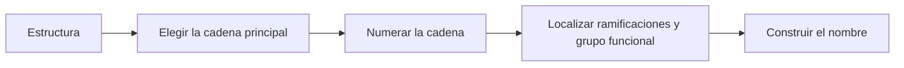

# Nomenclatura orgánica: de la cadena al nombre

**Objetivo:** nombrar ejemplos sencillos de alcanos, alquenos y alcoholes.
**Extensiones:** SMILES y Mermaid.

## Un procedimiento para esta clase

Elige una cadena principal adecuada, numérala para localizar los grupos
relevantes y combina el tamaño de la cadena, la insaturación y la función. Las
reglas de prioridad se vuelven más complejas cuando hay varias funciones; esta
clase trabaja con una función principal por molécula.



## Tres ejemplos resueltos

`CCCC` representa una cadena sin ramificaciones, con cuatro carbonos y enlaces
simples: **butano**. El prefijo `but-` indica cuatro carbonos.

```smiles
CCCC
```

En `CC=CC`, el enlace doble está entre los carbonos 2 y 3: **but-2-eno**. Esta
escritura no especifica la configuración espacial del enlace doble.

```smiles
CC=CC
```

En `CC(O)C`, la cadena principal tiene tres carbonos y el OH está en el carbono
2: **propan-2-ol**. Los paréntesis registran una ramificación en SMILES.

```smiles
CC(O)C
```

## Ramificaciones

```smiles
CC(C)CC
```

La cadena principal tiene cuatro carbonos y un grupo metilo en el carbono 2:
**2-metilbutano**. Numerar desde el otro extremo daría 3; elegimos 2.

## Practica

1. Nombra `CCC`.
2. Nombra `CCCO`, considerando el OH terminal.
3. ¿Por qué contar todos los carbonos no basta para elegir el prefijo de la
   cadena principal?

## Respuestas comentadas

1. Propano.
2. Propan-1-ol.
3. Los carbonos de las ramificaciones no pertenecen necesariamente a la cadena
   principal.
