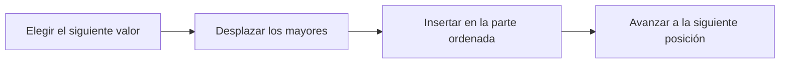

# Ordenación por inserción: construir una parte ordenada

**Objetivo:** seguir comparaciones y desplazamientos en un algoritmo.
**Extensiones:** Mermaid, syntax-highlight.

## Ideas clave

La ordenación por inserción mantiene ordenada una parte inicial del vector. En
cada paso toma el siguiente valor, desplaza los mayores a la derecha y lo
inserta en el lugar correcto. Se parece a organizar cartas en la mano.



```javascript
function insertionSort(values) {
    for (let i = 1; i < values.length; i += 1) {
        const key = values[i];
        let j = i - 1;
        while (j >= 0 && values[j] > key) {
            values[j + 1] = values[j];
            j -= 1;
        }
        values[j + 1] = key;
    }
    return values;
}
console.log(insertionSort([5, 2, 4, 1]));
```

En $[5,2,4,1]$, insertar 2 deja la parte inicial como $[2,5]$; insertar 4
produce $[2,4,5]$; insertar 1 termina en $[1,2,4,5]$. El código modifica el
vector original. El bloque es para lectura y no ejecuta JavaScript en el
documento.

La comparación estricta `>` conserva el orden relativo de valores iguales en
esta implementación. En el peor caso se requieren muchas comparaciones y
desplazamientos: el trabajo crece proporcionalmente a $n^2$. Un vector ya
ordenado necesita menos desplazamientos, lo que muestra que la entrada influye
en el coste.

## Practica

1. Ordena manualmente $[3,1,2]$.
2. ¿El vector devuelto por el algoritmo es una copia independiente?

## Respuestas comentadas

1. Tras insertar 1: $[1,3,2]$; tras insertar 2: $[1,2,3]$.
2. No; el algoritmo modifica el vector recibido.

## Sigue aprendiendo

[Índice de la colección](README.md) · [Volver a los ejercicios](#practica)

[Português brasileiro](../pt/ordenacao-insercao.md) ·
[English](../en/ordenacao-insercao.md)
