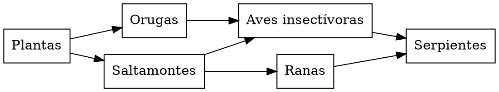

# Biología: una red alimentaria simplificada

**Objetivo:** interpretar las relaciones alimentarias y el flujo de energía.
**Extensión:** Graphviz.

## El significado de las flechas

En esta red ficticia, la flecha va del organismo consumido al consumidor:
indica la dirección de transferencia de materia y energía. Los organismos son
grupos genéricos y el diagrama no describe un ecosistema concreto.

## Red y cadena

Una cadena es un recorrido, como plantas → saltamontes → ranas → serpientes. La
red reúne varias cadenas conectadas. Un cambio en una población puede afectar
distintos caminos, pero el diagrama no cuantifica la intensidad de esas
relaciones. Se omitieron los descomponedores y otros organismos para facilitar
la lectura; no son prescindibles en el ecosistema.

## Practica

1. Identifica los productores de la red.
2. ¿Qué consumidores reciben energía directamente de los saltamontes?
3. ¿Por qué no podemos predecir la población de serpientes solo contando
   flechas?

## Respuestas comentadas

1. Las plantas.
2. Las aves insectívoras y las ranas.
3. Faltan cantidades, tasas, otros recursos e interacciones ambientales.
