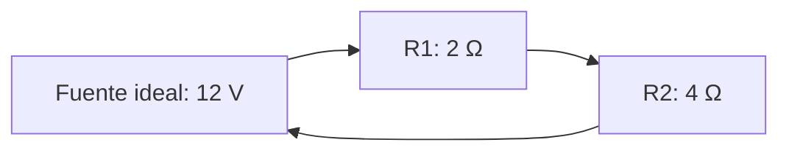

# Resistencias en serie: corriente y tensión

**Objetivo:** calcular la resistencia equivalente y repartir la tensión en un
modelo ideal. **Extensiones:** Mermaid, MathJax.

## Ideas clave

En una conexión en serie hay un único camino para la corriente. Para
resistencias óhmicas ideales, $R_{\mathrm{eq}}=R_1+R_2$. La misma corriente
atraviesa ambas, pero las caídas de tensión pueden ser distintas: $V_i=IR_i$.

El dibujo muestra la conectividad de un circuito cerrado, no símbolos
eléctricos convencionales. Con una fuente ideal de 12 V y resistencias de 2 Ω y
4 Ω, $R_{\mathrm{eq}}=6$ Ω e $I=12/6=2$ A. Las caídas son 4 V y 8 V; su suma
coincide con la tensión de la fuente.

El modelo desprecia la resistencia de los cables y los efectos de la
temperatura. La tensión es una diferencia de potencial; la corriente es flujo
de carga. Son magnitudes distintas con unidades diferentes. Esta es una
actividad de análisis sobre papel.

## Practica

1. Si la fuente pasa a 6 V, ¿cuál es la corriente?
2. ¿Qué resistencia tiene la mayor caída de tensión?

## Respuestas comentadas

1. 1 A, manteniendo las mismas resistencias.
2. La de 4 Ω: con igual corriente, la caída es proporcional a la resistencia.

## Sigue aprendiendo

[Índice de la colección](README.md) · [Volver a los ejercicios](#practica)

[Português brasileiro](../pt/resistores-em-serie.md) ·
[English](../en/resistores-em-serie.md)
