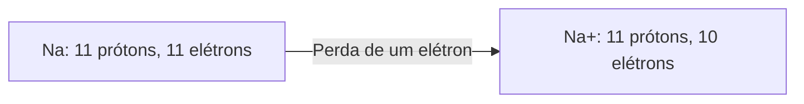

# Átomos e íons: carga e identidade

**Objetivo:** distinguir número atômico, número de massa e carga elétrica.
**Extensões:** Mermaid, MathJax.

## Ideias centrais

O número atômico $Z$ é o número de prótons. Ele determina o elemento. O número
de massa $A$ soma prótons e nêutrons: $A=Z+N$. A carga, em unidades da carga
elementar, é $q=Z-n_e$, com $n_e$ elétrons.

Um átomo neutro de sódio tem 11 prótons e 11 elétrons. Ao perder um elétron,
forma $\ce{Na+}$, com 10 elétrons. O núcleo não mudou; continua sendo sódio.

Isótopos têm o mesmo $Z$ e números de nêutrons diferentes. Íons diferem na
carga por terem ganho ou perdido elétrons. Esses dois conceitos não devem ser
confundidos. O diagrama mostra uma mudança na população de elétrons e não
representa suas trajetórias ou uma reação completa.

## Pratique

1. Um átomo tem $Z=6$ e $A=14$. Quantos nêutrons possui?
2. Se possui 8 elétrons, qual é sua carga?

## Respostas comentadas

1. $N=14-6=8$.
2. $q=6-8=-2$, em unidades da carga elementar.

## Continue estudando

[Índice da coleção](README.md) · [Voltar aos exercícios](#pratique)

[English](../en/atomos-e-ions.md) · [Español](../es/atomos-e-ions.md)
