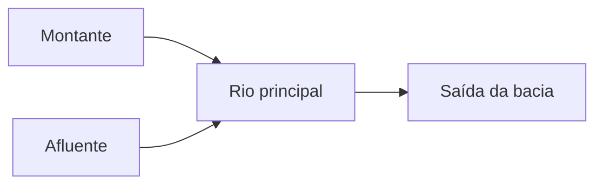

# Bacias hidrográficas: área e rede de drenagem

**Objetivo:** distinguir limite de bacia, curso de água e sentido de
escoamento. **Extensões:** maps/GeoJSON, Mermaid.

## Ideias centrais

Uma bacia hidrográfica reúne a área cujas águas drenam para uma saída comum.
Divisores de água separam bacias; não precisam coincidir com limites de
municípios. A rede inclui o rio principal e seus afluentes.

```geojson
{
    "type": "FeatureCollection",
    "features": [
        {
            "type": "Feature",
            "properties": {
                "name": "Bacia fictícia"
            },
            "geometry": {
                "type": "Polygon",
                "coordinates": [
                    [
                        [
                            -45,
                            -10
                        ],
                        [
                            -44,
                            -10
                        ],
                        [
                            -44,
                            -9
                        ],
                        [
                            -45,
                            -9
                        ],
                        [
                            -45,
                            -10
                        ]
                    ]
                ]
            }
        },
        {
            "type": "Feature",
            "properties": {
                "name": "Curso fictício"
            },
            "geometry": {
                "type": "LineString",
                "coordinates": [
                    [
                        -44.8,
                        -9.2
                    ],
                    [
                        -44.5,
                        -9.5
                    ],
                    [
                        -44.2,
                        -9.8
                    ]
                ]
            }
        }
    ]
}
```



O polígono e a linha são fictícios, em coordenadas geográficas, para comparar
uma área e um caminho. Não representam uma bacia real nem permitem deduzir
altitude a partir da latitude. O anel do polígono termina na mesma coordenada
em que começou.

A direção real do escoamento exige informação de relevo. O segundo diagrama
explicita um sentido didático para o fluxo. Alterações no uso do solo a
montante podem afetar água e sedimentos a jusante; por isso, estudar somente um
trecho isolado pode ocultar relações importantes.

## Pratique

1. Qual geometria representa a área: Polygon ou LineString?
2. A ordem das coordenadas permite descobrir a direção real da corrente?

## Respostas comentadas

1. Polygon.
2. Não; é preciso relevo ou informação hidrológica adicional.

## Continue estudando

[Índice da coleção](README.md) · [Voltar aos exercícios](#pratique)

[English](../en/bacia-hidrografica.md) · [Español](../es/bacia-hidrografica.md)
