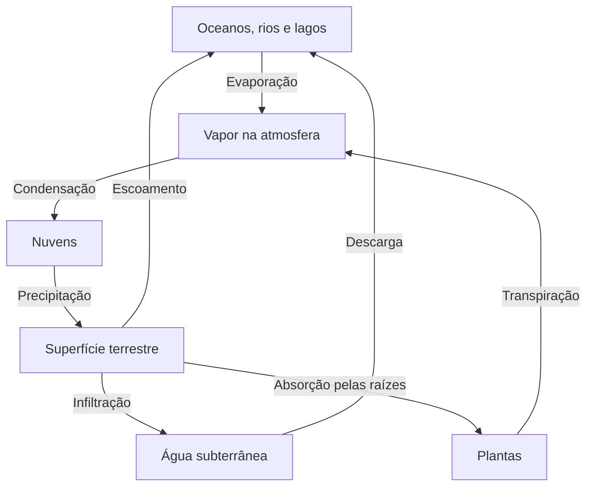

# O ciclo da água e a conservação da matéria

**Objetivo:** explicar transferências de água entre reservatórios.
**Extensão:** Mermaid.

## Um ciclo com vários caminhos

A energia solar favorece a evaporação. O vapor pode se condensar em gotículas e
cristais que formam nuvens; a precipitação devolve água à superfície. Parte
infiltra no solo e parte escoa. As plantas também devolvem água à atmosfera
pela transpiração.

As setas representam processos, não tempos iguais. Uma molécula de água pode
permanecer muito mais tempo em um aquífero do que em uma nuvem. A matéria
circula, enquanto a energia é transferida e dissipada.

## Um problema urbano

Pavimentar um terreno tende a reduzir a infiltração e aumentar o escoamento
superficial. Jardins de chuva e áreas permeáveis podem favorecer a retenção
local, mas sua eficiência depende do solo, da manutenção e da intensidade da
chuva.

## Pratique

1. Qual seta do diagrama corresponde à formação de nuvens?
2. Por que o ciclo não deve ser desenhado como uma única sequência linear?
3. O que pode acontecer ao escoamento após a impermeabilização do solo?

## Respostas comentadas

1. A condensação do vapor.
2. Existem caminhos alternativos e reservatórios com tempos de permanência
   distintos.
3. Ele tende a aumentar, pois menos água consegue infiltrar.
