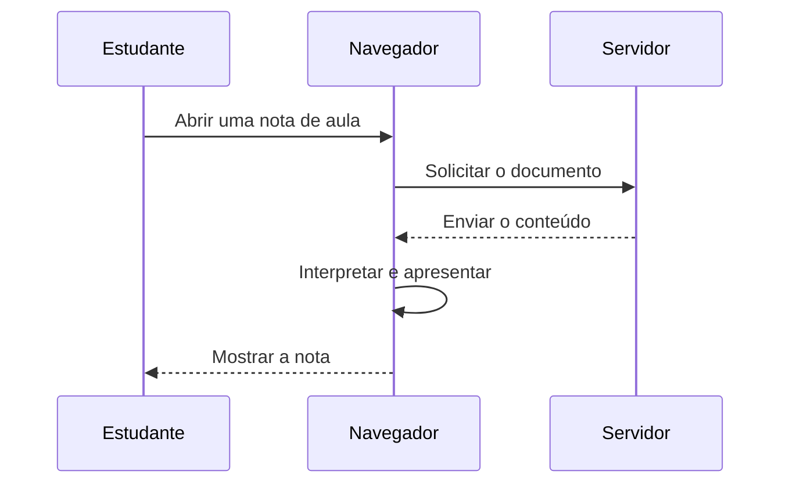

# Comunicação digital: pedido e resposta

**Objetivo:** distinguir cliente, servidor e troca de mensagens. **Extensão:**
Mermaid.

## A sequência de uma consulta

Um navegador pode solicitar um documento a um servidor. O servidor recebe o
pedido, localiza o recurso e devolve uma resposta. O diagrama representa uma
situação simplificada em que o recurso existe e a conexão funciona.

## Conteúdo e apresentação

Receber um texto Markdown e apresentá-lo são etapas diferentes. O navegador
pode usar um mecanismo para transformar títulos, tabelas e extensões em
elementos visuais. Diagramas e modelos exigem renderizadores próprios. Uma
falha de carregamento não significa necessariamente que o texto de origem
esteja errado: o recurso pode estar indisponível.

## Pratique

1. Quem inicia o pedido do documento?
2. Qual etapa transforma conteúdo em apresentação?
3. Onde incluiria uma resposta “recurso não encontrado” no diagrama?

## Respostas comentadas

1. O navegador, a partir da ação do estudante.
2. A etapa de interpretação e apresentação no navegador.
3. Na mensagem do servidor para o navegador, como caminho alternativo à
   resposta com conteúdo.
