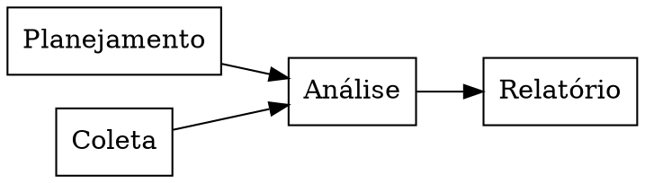

# Dependências de um projeto

**Extensões:** `graphviz`.

## Ideias principais

Uma seta A→B significa que B espera por A. O planejamento e a coleta podem
começar juntos; a análise precisa de ambos. Esse grafo acíclico descreve
precedências, não durações.

## Prática

O relatório pode começar antes da análise? Há uma dependência entre
planejamento e coleta?

## Resposta comentada

Não, segundo o grafo. Não há aresta entre planejamento e coleta; ambos podem
avançar de forma independente.

[Índice da coleção](README.md)

[English](../en/dependencias-de-projeto.md) ·
[Español](../es/dependencias-de-projeto.md)
