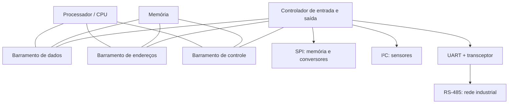
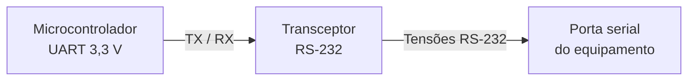
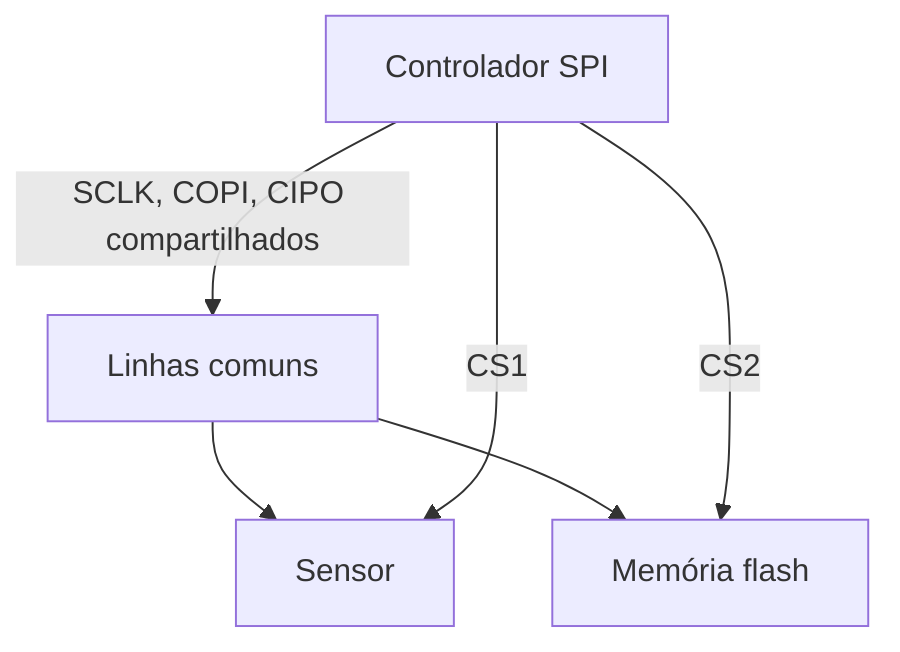
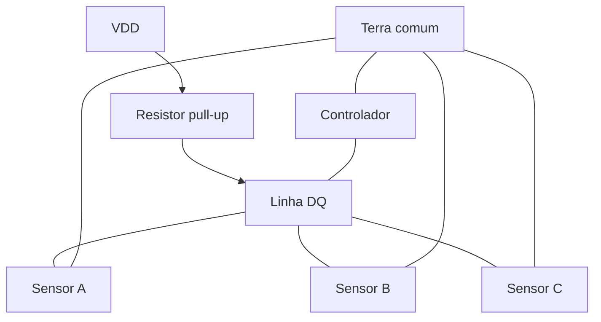
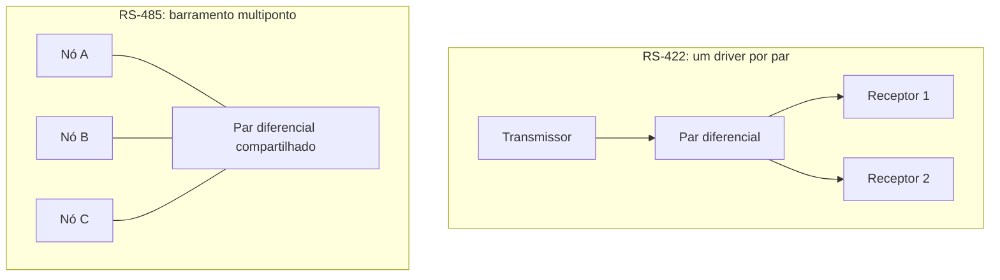
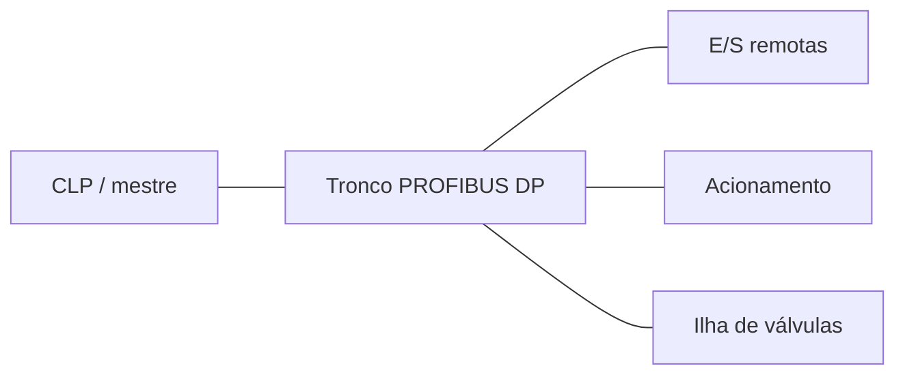
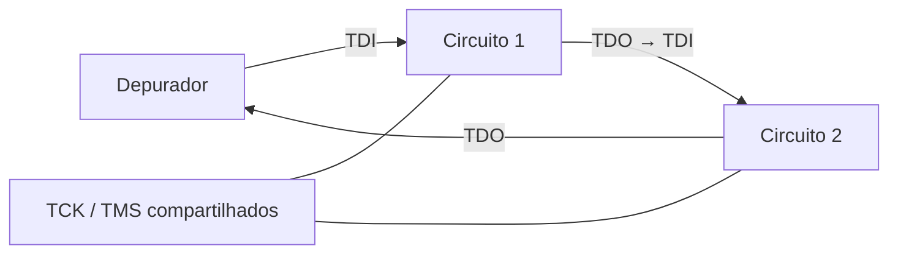
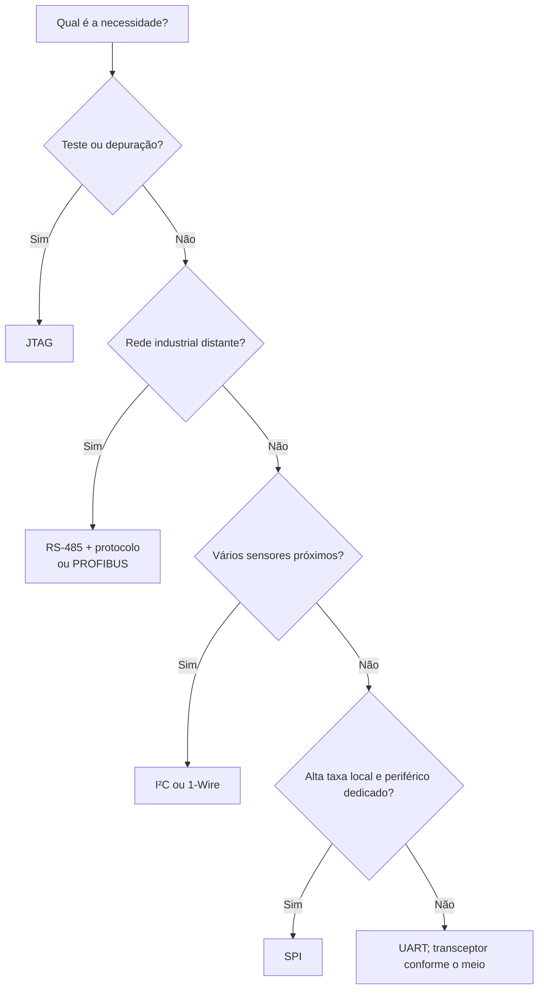

# Barramentos de comunicação digital: dos bits aos sistemas distribuídos

> **Física, eletrônica e computação.** Um percurso didático pelos barramentos
> de dados, pela transmissão serial e pelas interfaces SPI, UART, I²C, 1-Wire,
> RS-232, RS-422, RS-485, PROFIBUS e JTAG.

**Extensões exploradas:** `mermaid`, `wavedrom`, `circuitikz`, `tikz`,
`vega-lite`, `didactic`, `cross-references` e expressões matemáticas.

## 1. Introdução: como os circuitos conversam?

Um microcontrolador mede uma temperatura, registra os resultados em memória,
atualiza uma tela e transmite informações a um computador. Para realizar essas
tarefas, precisa trocar **bits** com outros componentes. A ligação entre eles
não é apenas um fio: inclui sinais elétricos, convenções de tempo, regras para
iniciar e encerrar transações e, frequentemente, mecanismos para detectar
erros.

O termo **barramento** designa um conjunto compartilhado de caminhos e regras
de comunicação. Em sua forma clássica, os barramentos de computadores são
divididos em linhas de **dados**, **endereços** e **controle**. Nos sistemas
embarcados, um barramento serial pode transportar dados e endereços em momentos
sucessivos, utilizando poucos condutores.

<!-- prettier-ignore -->
::: definition Barramento, interface e protocolo {#def-barramento}

- **Barramento:** meio de interconexão, frequentemente compartilhado por vários
  dispositivos.
- **Interface física:** níveis de tensão, correntes, impedâncias e conectores,
  quando especificados.
- **Protocolo:** organização das mensagens, endereçamento, arbitragem,
  temporização e tratamento de erros.
- **Controlador periférico:** circuito que implementa a transmissão e a
  recepção, como um UART ou um controlador SPI.

Esses conceitos se sobrepõem em algumas tecnologias, mas não são sinônimos.

:::

<!-- prettier-ignore -->
::: figure Arquitetura simplificada de um sistema computacional {#fig-system-bus}



:::

<!-- prettier-ignore -->
A {@ref fig-system-bus} é uma adaptação conceitual, construída em Mermaid, da representação clássica de um barramento de sistema. Em arquiteturas reais, pontes, hierarquias e interconexões ponto a ponto tornam a estrutura mais complexa.

## 2. Bits, sinais e tempo

Um bit é uma informação binária, mas sua representação física exige grandezas
mensuráveis. Em uma ligação elétrica, dois intervalos de tensão podem
representar `0` e `1`; em outras interfaces, o bit pode ser determinado pela
**diferença** entre as tensões de dois condutores.

A **taxa de bits** é dada por

$$R_b=\frac{N_{\mathrm{bits}}}{\Delta t}, \qquad T_b=\frac{1}{R_b}.$$

A 115 200 bit/s, a duração nominal de um bit é aproximadamente
$8{,}68\,\mu\mathrm{s}$. A taxa de símbolos (_baud_) coincide com a taxa de
bits apenas quando cada símbolo carrega um bit.

<!-- prettier-ignore -->
::: figure Um sinal digital e seu período de bit {#fig-bits}

```wavedrom
{
  signal: [
    {name: 'bit', wave: '==.==.==.==.==.==.==.==', data: ['1','0','1','1','0','0','1','0']},
    {name: 'nível', wave: '10110010'}
  ],
  head: {text: 'Oito intervalos de bit'},
  config: {hscale: 2}
}
```

:::

**Comunicação paralela** utiliza várias linhas para transportar bits
simultaneamente. **Comunicação serial** transporta os bits sucessivamente. A
comunicação serial pode operar em frequências elevadas porque evita, entre
outros problemas, o desencontro temporal (_skew_) entre numerosas linhas
paralelas.

| Critério             | Paralela                           | Serial                                           |
| -------------------- | ---------------------------------- | ------------------------------------------------ |
| Condutores de dados  | Vários                             | Um ou poucos                                     |
| Sincronização        | Entre várias linhas                | Entre símbolos ou por clock                      |
| Uso típico           | Interconexões internas específicas | Sensores, periféricos e redes                    |
| Limitação importante | Skew e número de pinos             | Codificação, temporização e integridade do sinal |

## 3. Comunicação síncrona e assíncrona

Na transmissão **síncrona**, transmissor e receptor compartilham uma referência
temporal explícita ou recuperada do sinal. Em SPI, por exemplo, existe uma
linha de clock. Na transmissão **assíncrona** típica de UART, não há linha de
clock compartilhada: cada quadro começa com um bit de início, permitindo ao
receptor localizar os instantes de amostragem.

<!-- prettier-ignore -->
::: figure Quadro UART 8N1: início, oito dados e parada {#fig-uart-wave}

```wavedrom
{
  signal: [
    {name: 'TX', wave: '10101001011', data: []},
    {name: 'fase', wave: '=========', data: ['idle','start','b0','b1','b2','b3','b4','b5','b6']},
    {name: 'restante', wave: '====', data: ['b7','stop','idle','idle']}
  ],
  head: {text: 'Esquema de fases: duração de cada bit constante'},
  config: {hscale: 2}
}
```

:::

<!-- prettier-ignore -->
A {@ref fig-uart-wave} é **esquemática**: as linhas de anotação indicam fases, não uma segunda transmissão sincronizada; para um quadro completo, cada bit deve ocupar exatamente um período $T_b$.

## 4. UART e RS-232: funções diferentes

O **UART** (_Universal Asynchronous Receiver/Transmitter_) transforma bytes
paralelos em quadros seriais e realiza a operação inversa. O formato **8N1**
contém um bit de início, oito bits de dados, nenhuma paridade e um bit de
parada: dez bits transmitidos para cada byte útil.

A eficiência de enquadramento é

$$\eta=\frac{8}{1+8+0+1}=0{,}8.$$

Portanto, uma conexão 115 200 bit/s com quadros 8N1 transporta, idealmente, até
11 520 bytes de dados por segundo, sem contar protocolos superiores.

**RS-232** não é sinônimo de UART: especifica características elétricas e
sinais de interface. Na sinalização RS-232 tradicional, a polaridade lógica é
invertida em relação ao UART de nível TTL/CMOS, e as tensões podem ser
positivas e negativas. Nunca conecte diretamente uma saída RS-232 clássica a um
pino UART de 3,3 V sem um transceptor apropriado.

<!-- prettier-ignore -->
::: figure Conversão entre UART lógico e RS-232 {#fig-uart-rs232}



:::

## 5. SPI: comunicação serial com clock

O **SPI** (_Serial Peripheral Interface_) utiliza tipicamente quatro sinais:
`SCLK` (clock), `MOSI` ou `COPI` (dados do controlador para o periférico),
`MISO` ou `CIPO` (sentido inverso) e `CS` (seleção do periférico,
frequentemente ativa em nível baixo). Em sua forma usual, transmite e recebe
bits simultaneamente, em _full duplex_.

<!-- prettier-ignore -->
::: figure SPI com dois periféricos e seleção individual {#fig-spi-topology}



:::

<!-- prettier-ignore -->
::: figure Transação SPI esquemática {#fig-spi-wave}

```wavedrom
{
  signal: [
    {name: 'CS_n', wave: '10......1'},
    {name: 'SCLK', wave: '0p......0'},
    {name: 'COPI', wave: 'x========x', data: ['7','6','5','4','3','2','1','0']},
    {name: 'CIPO', wave: 'x========x', data: ['7','6','5','4','3','2','1','0']}
  ],
  head: {text: 'SPI: oito posições de bit (ilustração conceitual)'},
  config: {hscale: 2}
}
```

:::

O instante de amostragem depende das configurações **CPOL** e **CPHA**.
Dispositivos que utilizam modos SPI incompatíveis não trocam dados
corretamente. A existência de clock não dispensa atenção a tempos de
estabelecimento (_setup_) e retenção (_hold_).

## 6. I²C: duas linhas e múltiplos dispositivos

O **I²C** (_Inter-Integrated Circuit_) usa duas linhas: `SDA` (dados) e `SCL`
(clock). As saídas são normalmente de dreno aberto ou coletor aberto: os
dispositivos puxam as linhas para baixo, enquanto resistores de _pull-up_ as
elevam ao nível lógico alto.

Essa estrutura permite compartilhar os fios e implementar confirmação (`ACK`),
endereçamento e, em determinadas condições, arbitragem entre controladores.

<!-- prettier-ignore -->
::: figure Barramento I²C com resistores de pull-up {#fig-i2c-circuit}

```circuitikz
\begin{circuitikz}[american]
\draw (0,0) node[ground]{} to[V,l=$V_{DD}$] (0,3);
\draw (0,3) -- (2,3) to[R,l=$R_{P1}$] (2,1) -- (6,1);
\draw (0,3) -- (4,3) to[R,l=$R_{P2}$] (4,0) -- (6,0);
\node[right] at (6,1) {SDA};
\node[right] at (6,0) {SCL};
\end{circuitikz}
```

:::

<!-- prettier-ignore -->
Os dois resistores da {@ref fig-i2c-circuit} representam os *pull-ups*; os dispositivos conectam seus transistores de saída entre cada linha e o terra. A capacitância distribuída do barramento influencia o tempo de subida.

Para uma aproximação RC de primeira ordem, o tempo de subida entre 30% e 70% da
tensão final é

$$t_r \approx 0{,}8473 R_P C_B.$$

Se $R_P=4{,}7\,\mathrm{k\Omega}$ e $C_B=100\,\mathrm{pF}$, resulta
$t_r\approx398\,\mathrm{ns}$. O valor adequado de $R_P$ depende também da
corrente que os dispositivos conseguem drenar e dos limites da modalidade I²C
empregada.

<!-- prettier-ignore -->
::: figure Início e fim de uma transação I²C {#fig-i2c-wave}

```wavedrom
{
  signal: [
    {name: 'SCL', wave: '1.0p....1'},
    {name: 'SDA', wave: '10.======1', data: ['endereço','R/W','ACK','dados','ACK','fim']}
  ],
  head: {text: 'START: SDA cai com SCL alto; STOP: SDA sobe com SCL alto'},
  config: {hscale: 2}
}
```

:::

<!-- prettier-ignore -->
O desenho da {@ref fig-i2c-wave} destaca **eventos lógicos**, não pretende reproduzir os tempos de cada pulso de um quadro completo.

## 7. 1-Wire: um condutor de dados

O barramento **1-Wire**, associado historicamente à Dallas Semiconductor/Maxim,
usa uma linha de dados e uma referência de terra. A linha de dados emprega
_pull-up_; o controlador inicia janelas temporais específicas para transmitir e
ler bits.

Dispositivos podem ter identificadores ROM de 64 bits, úteis para distinguir
vários sensores no mesmo fio. Alguns podem operar com **alimentação parasita**,
aproveitando energia fornecida pela própria linha, mas essa possibilidade impõe
cuidados de corrente, temporização e _strong pull-up_.

<!-- prettier-ignore -->
::: figure Topologia simplificada de um barramento 1-Wire {#fig-onewire}



:::

## 8. RS-422 e RS-485: sinalização diferencial

Na sinalização diferencial, a informação depende de

$$V_D=V_A-V_B.$$

Um ruído aproximadamente igual nos dois fios tende a ser rejeitado pelo
receptor, desde que a tensão de modo comum permaneça dentro de sua faixa
admissível. O par trançado ajuda a tornar semelhantes os acoplamentos de
interferência.

**RS-422** descreve uma interface diferencial com um transmissor por par e
possibilidade de múltiplos receptores. **RS-485** permite que diferentes
transmissores compartilhem um par, desde que somente o transmissor autorizado o
conduza em cada instante. RS-485 define características elétricas, **não** o
formato das mensagens.

<!-- prettier-ignore -->
::: figure Diferença entre RS-422 e RS-485 {#fig-rs-topology}



:::

As letras `A` e `B` nos terminais de módulos comerciais nem sempre seguem a
mesma convenção de polaridade entre fabricantes. Antes de ligar equipamentos,
confira a documentação do transceptor.

### Terminação e reflexões

Uma linha longa deve ser tratada como **linha de transmissão** quando o tempo
de propagação se torna significativo em comparação com o tempo de subida do
sinal. Uma terminação resistiva aproximadamente igual à impedância
característica reduz reflexões:

$$\Gamma=\frac{Z_L-Z_0}{Z_L+Z_0}.$$

Para $Z_L=Z_0$, o coeficiente de reflexão ideal é zero. Em barramentos RS-485
com cabo de aproximadamente $120\,\Omega$, é comum instalar um resistor de
$120\,\Omega$ em **cada extremidade física** do tronco, e não em todos os nós.

<!-- prettier-ignore -->
::: figure Terminação resistiva em uma extremidade do par {#fig-rs485-termination}

```circuitikz
\begin{circuitikz}[american]
\draw (0,2) -- (5,2) node[right]{A};
\draw (0,0) -- (5,0) node[right]{B};
\draw (4,2) to[R,l=$120\,\Omega$] (4,0);
\node[left] at (0,2) {Par A};
\node[left] at (0,0) {Par B};
\end{circuitikz}
```

:::

## 9. PROFIBUS: comunicação industrial

**PROFIBUS** é uma família de redes industriais. Na variante **PROFIBUS DP**, é
frequente a utilização da camada física **RS-485**, com topologia de barramento
linear, conectores e terminações apropriados. PROFIBUS PA utiliza outra camada
física, adequada a aplicações de processo.

Em segmentos RS-485 de PROFIBUS DP, uma rede de terminação **ativa** típica
combina resistores de polarização e um resistor entre as linhas: frequentemente
$390\,\Omega$ para VP (5 V), $220\,\Omega$ entre as linhas e $390\,\Omega$ para
DGND. Essa rede **não** deve ser confundida com a terminação simples de
$120\,\Omega$ utilizada em muitos barramentos RS-485 genéricos. Valores,
alimentação e ligação devem obedecer ao equipamento e ao padrão aplicável.

<!-- prettier-ignore -->
::: figure Exemplo didático de terminação ativa PROFIBUS DP {#fig-profibus-termination}

```circuitikz
\begin{circuitikz}[american]
\draw (0,4) node[left]{VP (+5 V)} to[R,l=$390\,\Omega$] (0,2.6) -- (3,2.6) node[right]{B};
\draw (0,2.6) to[R,l=$220\,\Omega$] (0,1.3) -- (3,1.3) node[right]{A};
\draw (0,1.3) to[R,l=$390\,\Omega$] (0,0) node[ground]{};
\node[left] at (0,0) {DGND};
\end{circuitikz}
```

:::

<!-- prettier-ignore -->
A {@ref fig-profibus-termination} representa apenas a **rede de terminação e polarização**; não mostra a proteção, o transceptor, a blindagem ou a continuidade do cabo. O circuito deve permanecer alimentado para que a polarização ativa funcione como projetada. Não adicione capacitores arbitrariamente entre os fios: filtros RC alteram a forma de onda e precisam de dimensionamento específico.

<!-- prettier-ignore -->
::: figure Rede industrial com controlador e estações remotas {#fig-profibus-network}



:::

## 10. JTAG: teste, depuração e programação

**JTAG** refere-se à arquitetura de teste de fronteira (_boundary scan_)
padronizada principalmente pela IEEE 1149.1. Suas linhas usuais são `TCK`,
`TMS`, `TDI` e `TDO`; `TRST` pode ser opcional. A interface permite testar
interconexões e, dependendo do dispositivo, oferece acesso a funções de
depuração e programação.

Um componente JTAG contém um controlador de estados **TAP** (_Test Access
Port_), registradores de instruções e de dados. Vários circuitos podem ser
ligados em cadeia: o `TDO` de um alimenta o `TDI` do próximo.

<!-- prettier-ignore -->
::: figure Cadeia de varredura JTAG {#fig-jtag}



:::

O JTAG não deve ser tratado como substituto genérico de SPI ou I²C: seu
objetivo e sua organização são distintos.

## 11. Integridade do sinal: capacitância, ruído e velocidade

Os condutores possuem resistência, indutância e capacitância distribuídas. Em
uma ligação curta, um modelo RC pode ser suficiente para compreender a subida
de tensão. Em ligações longas ou com bordas rápidas, o comportamento de **linha
de transmissão** é essencial.

<!-- prettier-ignore -->
::: figure Resposta de subida normalizada de uma rede RC {#fig-rc-chart}

```vega-lite
{
  "$schema": "https://vega.github.io/schema/vega-lite/v5.json",
  "description": "Resposta normalizada de um circuito RC",
  "width": 550,
  "height": 230,
  "data": {
    "values": [
      {"t":0,"v":0},{"t":0.25,"v":0.2212},{"t":0.5,"v":0.3935},
      {"t":0.75,"v":0.5276},{"t":1,"v":0.6321},{"t":1.5,"v":0.7769},
      {"t":2,"v":0.8647},{"t":2.5,"v":0.9179},{"t":3,"v":0.9502},
      {"t":4,"v":0.9817},{"t":5,"v":0.9933}
    ]
  },
  "mark": {"type":"line","point":true},
  "encoding": {
    "x":{"field":"t","type":"quantitative","title":"Tempo t / RC"},
    "y":{"field":"v","type":"quantitative","title":"Tensão V / Vfinal","scale":{"domain":[0,1]}}
  }
}
```

:::

<!-- prettier-ignore -->
::: figure Modelo RC de uma linha com resistor de pull-up {#fig-rc-circuit}

```circuitikz
\begin{circuitikz}[american]
\draw (0,0) node[ground]{} to[V,l=$V_{DD}$] (0,3)
      to[R,l=$R_P$] (3,3) -- (5,3)
      to[C,l=$C_B$] (5,0) -- (0,0);
\node[above] at (5,3) {Linha de dados};
\end{circuitikz}
```

:::

<!-- prettier-ignore -->
Na {@ref fig-rc-circuit}, $C_B$ representa a capacitância equivalente do condutor e das entradas conectadas. O modelo concentra essa capacitância em um único componente para facilitar a análise; a distribuição real é mais complexa.

<!-- prettier-ignore -->
A curva da {@ref fig-rc-chart} obedece à equação

$$V(t)=V_\infty\left(1-e^{-t/(RC)}\right).$$

Uma resistência de _pull-up_ menor acelera a subida, mas aumenta a corrente
quando a linha está em nível baixo. A escolha envolve compromisso entre
velocidade, consumo e capacidade de acionamento.

## 12. Comparando tecnologias

| Tecnologia  | Clock separado    | Meio físico usual         | Compartilhamento              | Aplicação                       |
| ----------- | ----------------- | ------------------------- | ----------------------------- | ------------------------------- |
| UART        | Não               | Níveis lógicos locais     | Em geral ponto a ponto        | Comunicação entre controladores |
| RS-232      | Não especifica    | Sinalização desbalanceada | Ponto a ponto                 | Portas seriais                  |
| SPI         | Sim               | Linhas lógicas            | Seleção por CS                | Memórias e conversores          |
| I²C         | Sim, SCL          | Duas linhas com pull-up   | Multidispositivo              | Sensores e periféricos          |
| 1-Wire      | Não               | Dados + referência        | Multidispositivo              | Sensores e identificação        |
| RS-422      | Não especifica    | Par diferencial           | Um driver por par             | Enlaces robustos                |
| RS-485      | Não especifica    | Par diferencial           | Múltiplos drivers coordenados | Automação                       |
| PROFIBUS DP | Depende da camada | Frequentemente RS-485     | Rede industrial               | CLPs e dispositivos de campo    |
| JTAG        | Sim, TCK          | Sinais lógicos            | Cadeia de teste               | Depuração e teste               |

Não é correto comparar todos os itens como se fossem protocolos de uma mesma
camada: alguns especificam sinalização elétrica, outros formato de transações,
e outros sistemas de comunicação mais completos.

## 13. Escolhendo uma interface

<!-- prettier-ignore -->
::: figure Árvore de decisão simplificada {#fig-decision}



:::

<!-- prettier-ignore -->
A árvore da {@ref fig-decision} é uma orientação inicial, não um procedimento normativo. Distância, taxa, imunidade eletromagnética, consumo, número de pinos, isolamento galvânico, segurança funcional e disponibilidade de componentes precisam ser avaliados em cada projeto.

## 14. Atividades e problemas resolvidos

<!-- prettier-ignore -->
:::: exercise Exercício 1 — Vazão efetiva de uma UART {#ex-uart}

Uma UART transmite quadros 8N1 a 9 600 bit/s. Quantos bytes úteis por segundo
podem ser transmitidos idealmente?

<!-- prettier-ignore -->
::: hint Uma pista

Conte todos os bits do quadro, não apenas os oito bits de dados.

:::

<!-- prettier-ignore -->
::: solution Resolução

Cada quadro contém 10 bits. Logo, $9600/10=960$ bytes úteis por segundo, antes
de eventuais pausas e sobrecargas de protocolo.

:::

::::

<!-- prettier-ignore -->
:::: exercise Exercício 2 — Tempo de subida de I²C {#ex-i2c}

Considere $R_P=2{,}2\,\mathrm{k\Omega}$ e $C_B=150\,\mathrm{pF}$. Estime o
tempo de subida de 30% a 70%.

<!-- prettier-ignore -->
::: solution Resolução

$$t_r\approx0{,}8473(2200)(150\times10^{-12})\approx280\,\mathrm{ns}.$$

É necessário comparar esse resultado com o limite aplicável ao modo I²C e
verificar a corrente de nível baixo.

:::

::::

<!-- prettier-ignore -->
:::: exercise Exercício 3 — Reflexão em uma linha {#ex-reflection}

Uma linha com $Z_0=120\,\Omega$ termina em $Z_L=240\,\Omega$. Calcule $\Gamma$.

<!-- prettier-ignore -->
::: solution Resolução

$$\Gamma=\frac{240-120}{240+120}=\frac13.$$

A reflexão ideal possui amplitude igual a um terço da onda incidente, com a
mesma polaridade.

:::

::::

<!-- prettier-ignore -->
:::: exercise Exercício 4 — Projeto de rede {#ex-network}

Um controlador deve ler sensores próximos, registrar dados em memória flash e
enviar comandos a módulos distribuídos por uma instalação industrial. Proponha
três interfaces.

<!-- prettier-ignore -->
::: hint Uma pista

Diferencie as distâncias e as exigências elétricas de cada enlace.

:::

<!-- prettier-ignore -->
::: solution Resolução comentada

Uma solução possível é **I²C** para sensores locais, **SPI** para memória flash
e **RS-485 com protocolo definido** para os módulos distantes. PROFIBUS DP pode
substituir a terceira escolha quando a instalação exigir interoperabilidade com
essa rede industrial. Em todos os casos, verificar os requisitos concretos dos
dispositivos.

:::

::::

## 15. Conclusão

O estudo dos barramentos une **lógica digital, eletricidade, eletromagnetismo,
temporização e organização de sistemas**. O bit é uma abstração; para
transmiti-lo, é preciso controlar tensões, correntes, instantes de amostragem e
interações entre condutores.

SPI, I²C e 1-Wire oferecem diferentes formas de interligar componentes
próximos. UART define uma organização assíncrona de quadros; RS-232, RS-422 e
RS-485 tratam de características elétricas. PROFIBUS organiza a comunicação
industrial sobre camadas físicas apropriadas. JTAG, por sua vez, transforma
interconexões e registradores em recursos observáveis de teste e depuração.

A escolha correta começa por uma pergunta simples: **o que deve ser comunicado,
entre quais componentes, a que distância, com que velocidade e sob quais
condições elétricas?**

## 16. Referências e leituras complementares

As páginas da Wikipédia em português e inglês oferecem uma visão introdutória e
ligações para outras línguas. Para projeto elétrico real, consulte as
especificações normativas e os manuais dos fabricantes.

- [Barramento (computação)](<https://pt.wikipedia.org/wiki/Barramento_(computa%C3%A7%C3%A3o)>)
- [Comunicação serial](https://pt.wikipedia.org/wiki/Comunica%C3%A7%C3%A3o_serial)
- [Serial Peripheral Interface](https://pt.wikipedia.org/wiki/Serial_Peripheral_Interface)
- [UART](https://pt.wikipedia.org/wiki/Universal_asynchronous_receiver/transmitter)
- [I²C](https://pt.wikipedia.org/wiki/I%C2%B2C)
- [1-Wire](https://pt.wikipedia.org/wiki/One_wire)
- [RS-232](https://pt.wikipedia.org/wiki/RS-232)
- [RS-422](https://en.wikipedia.org/wiki/RS-422)
- [RS-485](https://en.wikipedia.org/wiki/RS-485)
- [PROFIBUS](https://pt.wikipedia.org/wiki/Profibus)
- [JTAG](https://en.wikipedia.org/wiki/JTAG)
- [Documentação do mathjslab-markdown](https://github.com/MathJSLab/mathjslab-markdown)
