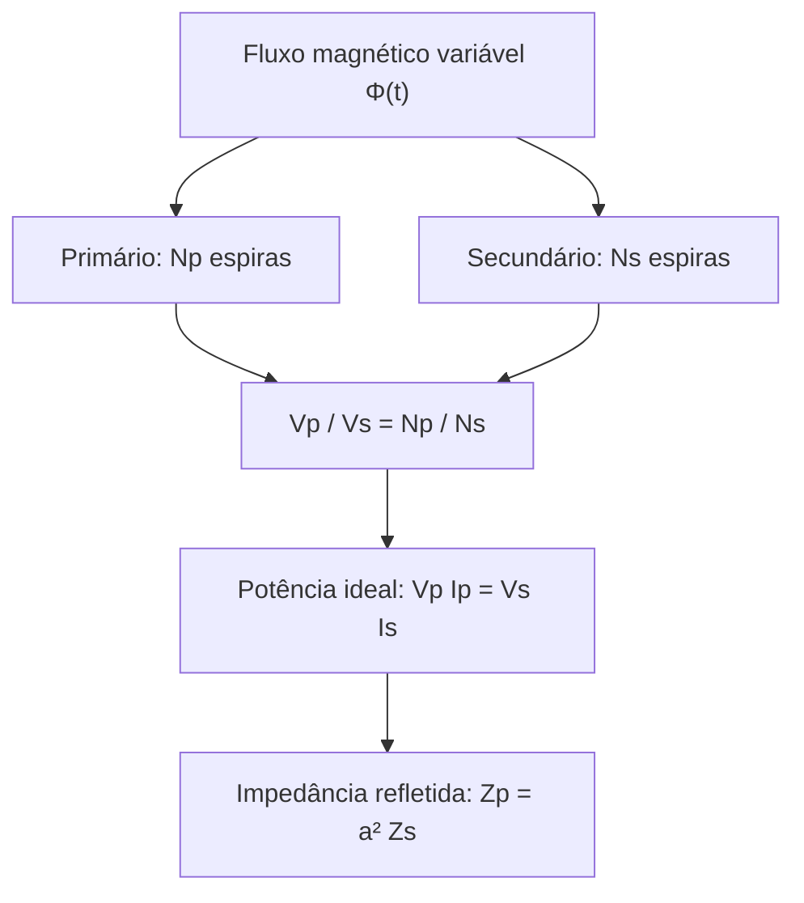
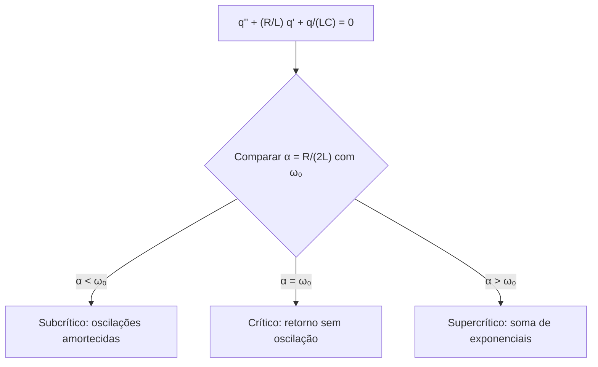
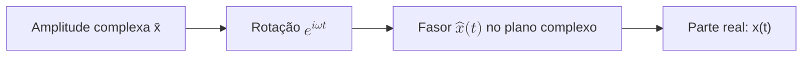

# Circuitos Elétricos

## Introdução

A aplicação prática mais comum do eletromagnetismo são os circuitos elétricos.
Um circuito elétrico é a ligação de elementos elétricos, tais como resistores,
indutores, capacitores, fontes de tensão, fontes de corrente e interruptores,
de modo que formem pelo menos um caminho fechado para a corrente elétrica.

## 1. Elementos de circuito

Na modelagem teórica dos circuitos é conveniente representar os elementos que
os compõem de forma idealizada. Os condutores que interligam os elementos do
circuito não têm resistência nula, mas, por serem constituídos de metais com
baixa resistividade, quando relativamente curtos considera-se sua resistência
desprezível. Uma bobina real, além de sua autoindutância, também tem
resistência e capacitância entre seus terminais. É conveniente dissociar esses
efeitos e representá-los por resistências, capacitâncias e indutâncias ideais.

Os elementos de circuito podem ser ativos ou passivos. Na convenção passiva, a
corrente entra pelo terminal de maior potencial do elemento consumidor de
energia. Geradores podem fornecer energia ao circuito, fazendo a corrente sair
por seu terminal de maior potencial.

### 1.1. Resistor

<!-- prettier-ignore -->
Um resistor é representado pelo símbolo da {@ref fig-resistor}. Usamos numerar
os terminais dos elementos de circuito. Neste caso, os terminais 1 e 2.

<!-- prettier-ignore -->
::: figure Resistor ideal com terminais 1 e 2 {#fig-resistor}

```circuitikz
\begin{circuitikz}[american,scale=3,transform shape]
\usetikzlibrary{arrows.meta}

\draw (0,0) node[left]{1} to[short,o-] (1,0)
      to[R,l=$R$] (4,0)
      to[short,-o] (5,0) node[right]{2};

\draw[-{Stealth[length=4mm,width=2.5mm]},thick]
      (0.20,0.35) -- (0.95,0.35)
      node[midway,above] {$I$};
\end{circuitikz}
```

:::

Quando atravessado por uma corrente $I$, o resistor apresenta uma queda de
potencial $V_R=V_1-V_2$, no sentido da corrente, dada pela lei de Ohm:

$$V_R=RI.\tag{1.1}$$

No resistor há transformação de energia elétrica em energia térmica por efeito
Joule. A potência dissipada é:

$$P=I^2R=\frac{V_R^2}{R}.\tag{1.2}$$

### 1.2. Capacitor

<!-- prettier-ignore -->
::: figure Capacitor ideal {#fig-capacitor}

```circuitikz
\begin{circuitikz}[american,scale=3,transform shape]
\usetikzlibrary{arrows.meta}

\draw (0,0) node[left]{1} to[short,o-] (1,0)
      to[C,l=$C$] (4,0)
      to[short,-o] (5,0) node[right]{2};

\draw[-{Stealth[length=4mm,width=2.5mm]},thick]
      (0.20,0.35) -- (0.95,0.35)
      node[midway,above] {$I$};
\end{circuitikz}
```

:::

A queda de potencial entre as placas do capacitor é

$$V_1-V_2=V_C=\frac{q}{C},\tag{1.3}$$

onde $C$ é a capacitância. Apesar de as placas estarem separadas por um
isolante, durante a carga e a descarga existe corrente nos terminais do
capacitor, definida por

$$I(t)=\frac{dq}{dt}.\tag{1.4}$$

No capacitor há armazenamento de energia no campo elétrico:

$$U=\frac{CV_C^2}{2}=\frac{q^2}{2C}.\tag{1.5}$$

### 1.3. Indutor

<!-- prettier-ignore -->
::: figure Indutor ideal {#fig-indutor}

```circuitikz
\begin{circuitikz}[american,scale=3,transform shape]
\usetikzlibrary{arrows.meta}

\draw (0,0) node[left]{1} to[short,o-] (1,0)
      to[L,l=$L$] (4,0)
      to[short,-o] (5,0) node[right]{2};

\draw[-{Stealth[length=4mm,width=2.5mm]},thick]
      (0.20,0.35) -- (0.95,0.35)
      node[midway,above] {$I$};
\end{circuitikz}
```

:::

A queda de potencial nos terminais do indutor é

$$V_1-V_2=V_L=L\frac{dI}{dt},\tag{1.6}$$

onde $L$ é a autoindutância. A energia armazenada no campo magnético é

$$U=\frac{LI^2}{2}.\tag{1.7}$$

### 1.4. Gerador

Um gerador ideal de tensão contínua mantém uma diferença de potencial entre
seus terminais independentemente da corrente que o atravessa.

<!-- prettier-ignore -->
::: figure Gerador ideal de tensão contínua {#fig-dc-source}

```circuitikz
\begin{circuitikz}[american,scale=3,transform shape]
\draw (0,3) node[above]{1}
      to[V,l=$V_0$,o-o] (0,0)
      node[below]{2};
\end{circuitikz}
```

:::

$$V_1-V_2=V_0.\tag{1.8}$$

Há geradores cuja diferença de potencial varia harmonicamente no tempo.

<!-- prettier-ignore -->
::: figure Gerador ideal de tensão alternada {#fig-ac-source}

```circuitikz
\begin{circuitikz}[american,scale=3,transform shape]
\draw (0,0) node[below]{2} to[sV,l=$V(t)$,o-o] (0,3) node[above]{1};
\end{circuitikz}
```

:::

$$V_1-V_2=V_0\cos(\omega t+\varphi).\tag{1.9}$$

## 2. Leis de Kirchhoff

A associação de elementos de circuito forma nós e malhas. Um **nó** é uma
junção de condutores; uma **malha** é um percurso fechado do circuito.

### 2.1. Primeira lei de Kirchhoff — lei dos nós

<!-- prettier-ignore -->
Em um nó sem acúmulo de carga, a soma das correntes que entram é igual à soma das correntes que saem. No exemplo da {@ref fig-node}:

$$I_1+I_2=I_3.\tag{2.1}$$

<!-- prettier-ignore -->
::: figure Correntes em um nó {#fig-node}

```circuitikz
\begin{circuitikz}[american,scale=3,transform shape]
\draw (0,2) to[short,i>^=$I_1$] (2,1);
\draw (0,0) to[short,i>^=$I_2$] (2,1);
\draw (2,1) node[circ]{} to[short,i>^=$I_3$] (4,1);
\end{circuitikz}
```

:::

Adotando sinal positivo para as correntes que entram e negativo para as que
saem:

$$\sum_{k=1}^{n} I_k=0.\tag{2.2}$$

Esta lei expressa a **conservação da carga elétrica**.

### 2.2. Segunda lei de Kirchhoff — lei das malhas

<!-- prettier-ignore -->
Em um percurso fechado, a soma algébrica das diferenças de potencial é nula. No circuito da {@ref fig-loop}, uma fonte alimenta três resistores:

$$V_0=V_1+V_2+V_3.\tag{2.3}$$

<!-- prettier-ignore -->
::: figure Malha simples com três resistores {#fig-loop}

```circuitikz
\begin{circuitikz}[american,scale=3,transform shape]
\draw (0,3) to[V,l=$V_0$] (0,0)
      to[R,l=$R_3$] (4,0)
      to[R,l=$R_2$] (4,3)
      to[R,l=$R_1$] (0,3);
\end{circuitikz}
```

:::

De forma geral,

$$\sum_{k=1}^{n}V_k=0.\tag{2.4}$$

Esta lei decorre da **conservação da energia** na aproximação de circuitos
concentrados.

## 3. Transientes

### 3.1. Circuito RC

<!-- prettier-ignore -->
Considere o circuito RC da {@ref fig-rc}. No instante $t=0$ a chave é fechada.

<!-- prettier-ignore -->
::: figure Circuito RC série alimentado por fonte contínua {#fig-rc}

```circuitikz
\begin{circuitikz}[american,scale=3,transform shape]
\draw (0,4) to[V,l=$V_0$] (0,0);
\draw (0,4) to[closing switch] (2,4) to[short] (4,4)
      to[R,l=$R$] (4,2) to[C,l=$C$] (4,0) -- (0,0);
\node[above] at (2,4.35) {$t=0$};
\end{circuitikz}
```

:::

Pela segunda lei de Kirchhoff,

$$V_0=V_R+V_C.\tag{3.1}$$

Substituindo as equações (1), (3) e (4):

$$V_0=R\frac{dq}{dt}+\frac{q(t)}{C}.\tag{3.2}$$

Multiplicando por $C$ e definindo a constante de tempo

$$\tau_C=RC,\tag{3.3}$$

obtemos

$$V_0C=\tau_C\frac{dq}{dt}+q(t).\tag{3.4}$$

Com condição inicial $q(0)=q_0$,

$$q(t)=(q_0-V_0C)e^{-t/\tau_C}+V_0C.\tag{3.5}$$

Derivando, encontramos a corrente:

$$I(t)=\frac{V_0-V_{C0}}{R}e^{-t/\tau_C},\tag{3.6}$$

onde $V_{C0}=q_0/C$. Definindo $I_0=(V_0-V_{C0})/R$:

$$I(t)=I_0e^{-t/\tau_C}.\tag{3.7}$$

<!-- prettier-ignore -->
::: figure Decaimento da corrente no circuito RC {#fig-rc-curve}

```vega-lite
{
  "$schema":"https://vega.github.io/schema/vega-lite/v5.json",
  "description":"Corrente normalizada durante a carga de um circuito RC",
  "width":960,"height":320,
  "data":{"sequence":{"start":0,"stop":5.01,"step":0.1,"as":"x"}},
  "transform":[{"calculate":"exp(-datum.x)","as":"y"}],
  "mark":{"type":"line"},
  "encoding":{"x":{"field":"x","type":"quantitative","title":"Tempo t / τC"},"y":{"field":"y","type":"quantitative","title":"Corrente I / I₀","scale":{"domain":[0,1]}}},
  "config": {
    "axis": {
      "titleFontSize": 24,
      "labelFontSize": 20,
      "titlePadding": 16,
      "labelPadding": 8,
      "tickSize": 8
    }
  }
}
```

:::

Em $t=\tau_C$, a corrente é $I_0/e$, aproximadamente 36,8% de seu valor
inicial.

### 3.2. Circuito RL

<!-- prettier-ignore -->
Considere o circuito RL da {@ref fig-rl}. A chave é fechada em $t=0$.

<!-- prettier-ignore -->
::: figure Circuito RL série alimentado por fonte contínua {#fig-rl}

```circuitikz
\begin{circuitikz}[american,scale=3,transform shape]
\draw (0,4) to[V,l=$V_0$] (0,0);
\draw (0,4) to[closing switch] (2,4) -- (4,4)
      to[R,l=$R$] (4,2) to[L,l=$L$] (4,0) -- (0,0);
\node[above] at (2,4.35) {$t=0$};
\end{circuitikz}
```

:::

Pela segunda lei de Kirchhoff,

$$V_0=V_R+V_L.\tag{3.8}$$

Substituindo (1) e (6):

$$V_0=RI(t)+L\frac{dI}{dt}.\tag{3.9}$$

Definindo

$$\tau_L=\frac{L}{R},\tag{3.10}$$

obtemos

$$\frac{V_0}{R}=I(t)+\tau_L\frac{dI}{dt}.\tag{3.11}$$

Com $I(0)=0$,

$$I(t)=\frac{V_0}{R}\left(1-e^{-t/\tau_L}\right).\tag{3.12}$$

Se $I_\infty=V_0/R$:

$$I(t)=I_\infty\left(1-e^{-t/\tau_L}\right).\tag{3.13}$$

<!-- prettier-ignore -->
::: figure Crescimento da corrente no circuito RL {#fig-rl-curve}

```vega-lite
{
  "$schema":"https://vega.github.io/schema/vega-lite/v5.json",
  "description":"Corrente normalizada após fechamento da chave no circuito RL",
  "width":960,"height":320,
  "data":{"sequence":{"start":0,"stop":5.01,"step":0.1,"as":"x"}},
  "transform":[{"calculate":"1-exp(-datum.x)","as":"y"}],
  "mark":{"type":"line"},
  "encoding":{"x":{"field":"x","type":"quantitative","title":"Tempo t / τL"},"y":{"field":"y","type":"quantitative","title":"Corrente I / I∞","scale":{"domain":[0,1]}}},
  "config": {
    "axis": {
      "titleFontSize": 24,
      "labelFontSize": 20,
      "titlePadding": 16,
      "labelPadding": 8,
      "tickSize": 8
    }
  }
}
```

:::

## 4. Oscilações livres no circuito LC

<!-- prettier-ignore -->
Considere o circuito LC da {@ref fig-lc}.

<!-- prettier-ignore -->
::: figure Circuito LC ideal {#fig-lc}

```circuitikz
\begin{circuitikz}[american,scale=3,transform shape]
\draw (0,0) to[C,l=$C$] (0,3) -- (4,3) to[L,l=$L$] (4,0) -- (0,0);
\end{circuitikz}
```

:::

Pela segunda lei de Kirchhoff,

$$V_C+V_L=0.\tag{4.1}$$

Substituindo (3) e (6),

$$\frac{q(t)}{C}+L\frac{dI}{dt}=0.\tag{4.2}$$

Definindo a frequência angular natural

$$\omega_0=\frac{1}{\sqrt{LC}},\tag{4.3}$$

obtemos a equação diferencial do oscilador harmônico livre:

$$\frac{d^2q}{dt^2}+\omega_0^2q(t)=0.\tag{4.4}$$

Com $q(0)=q_0$ e $I(0)=I_0$, a solução é

$$q(t)=q_0\cos(\omega_0t)+\frac{I_0}{\omega_0}\operatorname{sen}(\omega_0t).\tag{4.5}$$

Derivando:

$$I(t)=I_0\cos(\omega_0t)-q_0\omega_0\operatorname{sen}(\omega_0t).\tag{4.6}$$

A corrente pode ser escrita como

$$I(t)=A\cos(\omega_0t+\varphi).\tag{4.7}$$

Pela identidade trigonométrica,

$$\cos(\omega_0t+\varphi)=\cos(\omega_0t)\cos\varphi-\operatorname{sen}(\omega_0t)\operatorname{sen}\varphi,\tag{4.8}$$

identificamos

$$I_0=A\cos\varphi,\qquad q_0\omega_0=A\operatorname{sen}\varphi.\tag{4.9}$$

Logo,

$$A=\sqrt{I_0^2+q_0^2\omega_0^2},\tag{4.10}$$

$$\varphi=\operatorname{atan2}(q_0\omega_0,I_0).\tag{4.11}$$

Integrando (31), sem acrescentar uma constante independente das condições
iniciais,

$$q(t)=\frac{A}{\omega_0}\operatorname{sen}(\omega_0t+\varphi).\tag{4.12}$$

## 5. Oscilações amortecidas no circuito RLC

<!-- prettier-ignore -->
Considere o circuito RLC série sem gerador da {@ref fig-rlc}.

<!-- prettier-ignore -->
::: figure Circuito RLC série {#fig-rlc}

```circuitikz
\begin{circuitikz}[american,scale=3,transform shape]
\draw (0,0) to[C,l=$C$] (0,3) to[R,l=$R$] (4,3) to[L,l=$L$] (4,0) -- (0,0);
\end{circuitikz}
```

:::

Pela segunda lei de Kirchhoff,

$$V_R+V_C+V_L=0.\tag{5.1}$$

Portanto,

$$RI(t)+\frac{q(t)}{C}+L\frac{dI}{dt}=0.\tag{5.2}$$

Utilizando $I=dq/dt$, $\tau_L=L/R$ e $\omega_0=1/\sqrt{LC}$:

$$\frac{d^2q}{dt^2}+\frac{1}{\tau_L}\frac{dq}{dt}+\omega_0^2q(t)=0.\tag{5.3}$$

Para **amortecimento subcrítico**, $1/(2\tau_L)<\omega_0$, definimos

$$\alpha=\frac{1}{2\tau_L},\qquad \omega_1=\sqrt{\omega_0^2-\alpha^2}.\tag{5.4}$$

A solução com $q(0)=q_0$ e $I(0)=I_0$ é

$$q(t)=e^{-\alpha t}\left[q_0\cos(\omega_1t)+\frac{I_0+\alpha q_0}{\omega_1}\operatorname{sen}(\omega_1t)\right].\tag{5.5}$$

A corrente obtida por derivação é

$$I(t)=e^{-\alpha t}\left[I_0\cos(\omega_1t)-\frac{\alpha I_0+\omega_0^2q_0}{\omega_1}\operatorname{sen}(\omega_1t)\right].\tag{5.6}$$

Escrevendo-a na forma de oscilação amortecida,

$$I(t)=Ae^{-\alpha t}\cos(\omega_1t+\varphi).\tag{5.7}$$

A identidade usada é

$$\cos(\omega_1t+\varphi)=\cos(\omega_1t)\cos\varphi-\operatorname{sen}(\omega_1t)\operatorname{sen}\varphi.\tag{5.8}$$

Comparando os coeficientes,

$$I_0=A\cos\varphi,\qquad \frac{\alpha I_0+\omega_0^2q_0}{\omega_1}=A\operatorname{sen}\varphi.\tag{5.9}$$

Consequentemente,

$$A=\sqrt{I_0^2+\left(\frac{\alpha I_0+\omega_0^2q_0}{\omega_1}\right)^2},\tag{5.10}$$

$$\varphi=\operatorname{atan2}\left(\frac{\alpha I_0+\omega_0^2q_0}{\omega_1},I_0\right).\tag{5.11}$$

<!-- prettier-ignore -->
::: figure Oscilação amortecida e envoltórias exponenciais {#fig-rlc-curve}

```vega-lite
{
  "$schema":"https://vega.github.io/schema/vega-lite/v5.json",
  "description":"Exemplo ilustrativo: corrente oscilatória amortecida e envoltórias",
  "width":960,"height":320,
  "data":{"sequence":{"start":0,"stop":18.05,"step":0.05,"as":"t"}},
  "transform":[{"calculate":"exp(-0.15*datum.t)*cos(2.5*datum.t)","as":"i"},{"calculate":"exp(-0.15*datum.t)","as":"upper"},{"calculate":"-exp(-0.15*datum.t)","as":"lower"}],
  "layer":[
    {"mark":{"type":"line"},"encoding":{"x":{"field":"t","type":"quantitative","title":"Tempo (unidades arbitrárias)"},"y":{"field":"i","type":"quantitative","title":"Corrente normalizada"}}},
    {"mark":{"type":"line","strokeDash":[5,5],"opacity":0.65},"encoding":{"x":{"field":"t","type":"quantitative"},"y":{"field":"upper","type":"quantitative"}}},
    {"mark":{"type":"line","strokeDash":[5,5],"opacity":0.65},"encoding":{"x":{"field":"t","type":"quantitative"},"y":{"field":"lower","type":"quantitative"}}}
  ],
  "config": {
    "axis": {
      "titleFontSize": 24,
      "labelFontSize": 20,
      "titlePadding": 16,
      "labelPadding": 8,
      "tickSize": 8
    }
  }
}
```

:::

<!-- prettier-ignore -->
A {@ref fig-rlc-curve} ilustra a forma qualitativa do gráfico original; os parâmetros numéricos foram escolhidos somente para visualização.

## 6. Circuitos AC

A energia elétrica distribuída para uso industrial e residencial é
frequentemente transmitida em corrente alternada, em frequências de 60 Hz ou 50
Hz, dependendo do país. O emprego de transformadores permite elevar a tensão e
reduzir a corrente na transmissão, diminuindo as perdas resistivas por efeito
Joule, e depois reduzir a tensão no ponto de utilização.

### 6.1. Reatâncias e impedância

Em um resistor ligado a uma fonte alternada, a lei de Ohm estabelece

$$V(t)=RI(t).\tag{6.1}$$

Portanto, tensão e corrente estão em fase. Nos indutores e capacitores, a
corrente e a tensão podem apresentar defasagem. Para estudá-las, introduzimos a
representação complexa (fasorial):

$$V(t)=\operatorname{Re}[\widehat V(t)]=\operatorname{Re}[\overline V e^{i\omega t}]=V_0\cos(\omega t),\tag{6.2}$$

$$I(t)=\operatorname{Re}[\widehat I(t)]=\operatorname{Re}[\overline I e^{i\omega t}].\tag{6.3}$$

#### Capacitor em corrente alternada

<!-- prettier-ignore -->
::: figure Capacitor alimentado por fonte AC {#fig-ac-cap}

```circuitikz
\begin{circuitikz}[american,scale=3,transform shape]
\draw (0,0) to[sV,l=$V(t)$] (0,3) -- (3,3) to[C,l=$C$] (3,0) -- (0,0);
\end{circuitikz}
```

:::

A carga está relacionada à tensão por

$$q(t)=CV(t).\tag{6.4}$$

Assim,

$$I(t)=\frac{dq}{dt}=C\frac{dV}{dt}.\tag{6.5}$$

Na notação complexa,

$$\widehat I(t)=C\frac{d\widehat V}{dt}.\tag{6.6}$$

Derivando,

$$\overline I e^{i\omega t}=C\frac{d}{dt}\left(\overline V e^{i\omega t}\right)=i\omega C\overline V e^{i\omega t}.\tag{6.7}$$

Logo,

$$\overline I=i\omega C\overline V.\tag{6.8}$$

A impedância capacitiva e sua reatância são

$$Z_C=\frac{\overline V}{\overline I}=\frac{1}{i\omega C}=-\frac{i}{\omega C},\tag{6.9}$$

$$X_C=|Z_C|=\frac{1}{\omega C}.\tag{6.10}$$

Como $i=e^{i\pi/2}$,

$$\overline I=i\omega C\overline V=\omega CV_0e^{i\pi/2}.\tag{6.11}$$

Portanto,

$$I(t)=\omega CV_0\cos\left(\omega t+\frac{\pi}{2}\right).\tag{6.12}$$

**No capacitor, a corrente está adiantada de $\pi/2$ em relação à tensão.**

#### Indutor em corrente alternada

<!-- prettier-ignore -->
::: figure Indutor alimentado por fonte AC {#fig-ac-ind}

```circuitikz
\begin{circuitikz}[american,scale=3,transform shape]
\draw (0,0) to[sV,l=$V(t)$] (0,3) -- (3,3) to[L,l=$L$] (3,0) -- (0,0);
\end{circuitikz}
```

:::

A relação entre tensão e corrente é

$$V_0\cos(\omega t)=L\frac{dI}{dt}.\tag{6.13}$$

Na notação fasorial, $\widehat V(t)=L\,d\widehat I/dt$. Então,

$$\overline V e^{i\omega t}=L\frac{d}{dt}\left(\overline I e^{i\omega t}\right)=i\omega L\overline I e^{i\omega t}.\tag{6.14}$$

Logo,

$$\overline V=i\omega L\overline I.\tag{6.15}$$

A impedância indutiva e sua reatância são

$$Z_L=\frac{\overline V}{\overline I}=i\omega L,\tag{6.16}$$

$$X_L=|Z_L|=\omega L.\tag{6.17}$$

A corrente complexa é

$$\overline I=\frac{\overline V}{i\omega L}=\frac{V_0}{\omega L}e^{-i\pi/2}.\tag{6.18}$$

Portanto,

$$I(t)=\frac{V_0}{\omega L}\cos\left(\omega t-\frac{\pi}{2}\right).\tag{6.19}$$

**No indutor, a corrente está atrasada de $\pi/2$ em relação à tensão.**

#### Circuito RC em corrente alternada

<!-- prettier-ignore -->
::: figure Circuito RC série em corrente alternada {#fig-ac-rc}

```circuitikz
\begin{circuitikz}[american,scale=3,transform shape]
\draw (0,0) to[sV,l=$V(t)$] (0,4) -- (3,4) to[R,l=$R$] (3,2) to[C,l=$C$] (3,0) -- (0,0);
\end{circuitikz}
```

:::

Pela segunda lei de Kirchhoff,

$$V(t)=V_R(t)+V_C(t).\tag{6.20}$$

Substituindo as relações constitutivas,

$$V(t)=RI(t)+\frac{q(t)}{C}.\tag{6.21}$$

Derivando,

$$\frac{dV}{dt}=R\frac{dI}{dt}+\frac{I(t)}{C}.\tag{6.22}$$

Na representação complexa,

$$\frac{d\widehat V}{dt}=R\frac{d\widehat I}{dt}+\frac{\widehat I(t)}{C},\tag{6.23}$$

$$i\omega\widehat V(t)=i\omega R\widehat I(t)+\frac{\widehat I(t)}{C}.\tag{6.24}$$

A impedância total é

$$Z=\frac{\overline V}{\overline I}=R-\frac{i}{\omega C}=R-iX_C.\tag{6.25}$$

A relação fasorial é

$$\overline V=Z\overline I.\tag{6.26}$$

Escrevendo a impedância na forma polar, com $\varphi_{RC}>0$ indicando o
**módulo** da defasagem capacitiva:

$$Z=|Z|e^{-i\varphi_{RC}},\tag{6.27}$$

$$|Z|=\sqrt{R^2+\frac{1}{(\omega C)^2}}=\sqrt{R^2+X_C^2},\tag{6.28}$$

$$\varphi_{RC}=\arctan\left(\frac{1}{\omega RC}\right)=\arctan\left(\frac{X_C}{R}\right).\tag{6.29}$$

A corrente é

$$I(t)=\frac{V_0}{|Z|}\cos(\omega t+\varphi_{RC}).\tag{6.30}$$

#### Circuito RL em corrente alternada

<!-- prettier-ignore -->
::: figure Circuito RL série em corrente alternada {#fig-ac-rl}

```circuitikz
\begin{circuitikz}[american,scale=3,transform shape]
\draw (0,0) to[sV,l=$V(t)$] (0,4) -- (3,4) to[R,l=$R$] (3,2) to[L,l=$L$] (3,0) -- (0,0);
\end{circuitikz}
```

:::

Pela segunda lei de Kirchhoff,

$$V(t)=V_R(t)+V_L(t).\tag{6.31}$$

Substituindo as relações constitutivas,

$$V(t)=RI(t)+L\frac{dI}{dt}.\tag{6.32}$$

Na notação complexa,

$$\widehat V(t)=R\widehat I(t)+L\frac{d\widehat I}{dt},\tag{6.33}$$

$$\widehat V(t)=R\widehat I(t)+i\omega L\widehat I(t).\tag{6.34}$$

A impedância total é

$$Z=\frac{\overline V}{\overline I}=R+i\omega L=R+iX_L.\tag{6.35}$$

Na forma polar,

$$Z=|Z|e^{i\varphi_{RL}},\tag{6.36}$$

$$|Z|=\sqrt{R^2+(\omega L)^2}=\sqrt{R^2+X_L^2},\tag{6.37}$$

$$\varphi_{RL}=\arctan\left(\frac{\omega L}{R}\right)=\arctan\left(\frac{X_L}{R}\right).\tag{6.38}$$

A corrente é

$$I(t)=\frac{V_0}{|Z|}\cos(\omega t-\varphi_{RL}).\tag{6.39}$$

### 6.2. Valor eficaz e potência média

A corrente alternada é descrita, em um regime senoidal estacionário, por

$$v(t)=V_m\cos(\omega t+\varphi_v),\qquad i(t)=I_m\cos(\omega t+\varphi_i).\tag{6.40}$$

Os valores instantâneos mudam de sinal, mas o aquecimento de um resistor
depende do quadrado da corrente. Define-se o **valor eficaz** (_root mean
square_, RMS) como a corrente contínua que dissiparia a mesma potência média em
uma resistência:

$$I_{\mathrm{ef}}=\sqrt{\frac{1}{T}\int_0^T i^2(t)\,dt}.\tag{6.41}$$

Como a média de $\cos^2$ em um período é $1/2$, para uma senoide,

$$I_{\mathrm{ef}}=\frac{I_m}{\sqrt 2},\qquad V_{\mathrm{ef}}=\frac{V_m}{\sqrt 2}.\tag{6.42}$$

A potência instantânea recebida por um bipolo é $p(t)=v(t)i(t)$. Aplicando a
identidade $\cos a\cos b=\tfrac12[\cos(a-b)+\cos(a+b)]$:

$$p(t)=\frac{V_mI_m}{2}\left[\cos(\varphi_v-\varphi_i)+\cos(2\omega t+\varphi_v+\varphi_i)\right].\tag{6.43}$$

O segundo termo tem média nula ao longo de um período. Assim,

$$P_{\mathrm{média}}=V_{\mathrm{ef}}I_{\mathrm{ef}}\cos\varphi=I_{\mathrm{ef}}^2R,\qquad \varphi=\varphi_v-\varphi_i.\tag{6.44}$$

Em um circuito RLC série, $R$ representa a resistência total responsável pela
dissipação no modelo. Um indutor ou capacitor **ideal** armazena e devolve
energia ao circuito, mas não dissipa potência ativa média.

<!-- prettier-ignore -->
::: figure Tensão e corrente defasadas em regime senoidal {#fig-ac-phase}

```vega-lite
{
  "$schema":"https://vega.github.io/schema/vega-lite/v5.json",
  "description":"Tensão e corrente normalizadas, com defasagem de 45 graus",
  "width":960,"height":320,
  "data":{"sequence":{"start":0,"stop":12.61,"step":0.08,"as":"t"}},
  "transform":[
    {"calculate":"sin(datum.t)","as":"v"},
    {"calculate":"sin(datum.t-PI/4)","as":"i"},
    {"fold":["v","i"],"as":["grandeza","amplitude"]}
  ],
  "mark":{"type":"line"},
  "encoding":{
    "x":{"field":"t","type":"quantitative","title":"Tempo (ωt, rad)"},
    "y":{"field":"amplitude","type":"quantitative","title":"Amplitude normalizada"},
    "color":{"field":"grandeza","type":"nominal","title":"Sinal"}
  },
  "config": {
    "axis": {
      "titleFontSize": 24,
      "labelFontSize": 20,
      "titlePadding": 16,
      "labelPadding": 8,
      "tickSize": 8
    },
    "legend": {
      "titleFontSize": 24,
      "labelFontSize": 20,
      "titlePadding": 12,
      "labelPadding": 8,
      "symbolSize": 300,
      "symbolStrokeWidth": 3
    }
  }
}
```

:::

<!-- prettier-ignore -->
O gráfico da {@ref fig-ac-phase} usa valores normalizados e uma defasagem ilustrativa de $\pi/4$; não representa um circuito com componentes numericamente especificados.

A **potência aparente** e a **potência reativa**, em regime senoidal, são
definidas por

$$S=V_{\mathrm{ef}}I_{\mathrm{ef}},\qquad Q=V_{\mathrm{ef}}I_{\mathrm{ef}}\sin\varphi,\tag{6.45}$$

com unidades VA e var, respectivamente. O fator de potência é $\cos\varphi$.
Para uma carga puramente resistiva, $\varphi=0$ e $P=S$.

<!-- prettier-ignore -->
:::: exercise Aplicação — potência média em uma carga RL {#ex-potencia}

Uma carga RL série tem $R=30\,\Omega$ e $X_L=40\,\Omega$ e recebe
$V_{\mathrm{ef}}=100\,\mathrm V$. Calcule a corrente eficaz, o fator de
potência e a potência ativa.

<!-- prettier-ignore -->
::: hint

Calcule primeiro o módulo da impedância: $|Z|=\sqrt{R^2+X_L^2}$.

:::

<!-- prettier-ignore -->
::: solution Resolução

$|Z|=50\,\Omega$, $I_{\mathrm{ef}}=100/50=2\,\mathrm A$ e
$\cos\varphi=R/|Z|=0{,}6$. Portanto, $P=I_{\mathrm{ef}}^2R=120\,\mathrm W$.

:::

::::

## 7. Ressonância no circuito RLC

Quando um circuito RLC série é alimentado por uma fonte senoidal, sua
impedância é

$$Z(\omega)=R+i\left(\omega L-\frac{1}{\omega C}\right).\tag{7.1}$$

As reatâncias $X_L=\omega L$ e $X_C=1/(\omega C)$ têm dependências opostas com
a frequência. Na frequência de **ressonância série**, seus efeitos reativos se
cancelam:

$$X_L=X_C\quad\Longrightarrow\quad\omega_0=\frac{1}{\sqrt{LC}},\qquad f_0=\frac{1}{2\pi\sqrt{LC}}.\tag{7.2}$$

Na ressonância, $Z(\omega_0)=R$: a corrente eficaz é máxima para uma fonte de
tensão eficaz constante, e tensão e corrente de entrada estão em fase. As
tensões individuais sobre o indutor e o capacitor podem superar a tensão da
fonte, embora se oponham fasorialmente.

<!-- prettier-ignore -->
::: figure Circuito RLC série com fonte senoidal {#fig-resonant-rlc}

```circuitikz
\begin{circuitikz}[american,scale=3,transform shape]
\draw (0,0) to[sV,l=$v(t)$] (0,3)
      to[R,l=$R$] (2,3)
      to[L,l=$L$] (4,3)
      to[C,l=$C$] (4,0) -- (0,0);
\end{circuitikz}
```

:::

O módulo da corrente é

$$I_{\mathrm{ef}}(\omega)=\frac{V_{\mathrm{ef}}}{\sqrt{R^2+(\omega L-1/(\omega C))^2}}.\tag{7.3}$$

Definindo o **fator de qualidade** do RLC série,

$$Q_f=\frac{\omega_0L}{R}=\frac{1}{\omega_0RC}=\frac1R\sqrt{\frac LC},\tag{7.4}$$

obtemos uma medida de sua seletividade. Quanto maior $Q_f$, mais estreito é o
pico de corrente em torno da ressonância.

<!-- prettier-ignore -->
::: figure Curvas de ressonância para diferentes fatores de qualidade {#fig-resonance-curves}

```vega-lite
{
  "$schema":"https://vega.github.io/schema/vega-lite/v5.json",
  "description":"Resposta de corrente normalizada de RLC série, para diferentes Q",
  "width":960,"height":320,
  "data":{"sequence":{"start":0.2,"stop":2.81,"step":0.015,"as":"x"}},
  "transform":[
    {"calculate":"1/sqrt(1+pow(2*(datum.x-1/datum.x),2))","as":"Q2"},
    {"calculate":"1/sqrt(1+pow(5*(datum.x-1/datum.x),2))","as":"Q5"},
    {"calculate":"1/sqrt(1+pow(10*(datum.x-1/datum.x),2))","as":"Q10"},
    {"fold":["Q2","Q5","Q10"],"as":["curva","I"]}
  ],
  "mark":{"type":"line"},
  "encoding":{
    "x":{"field":"x","type":"quantitative","title":"Frequência normalizada ω/ω₀"},
    "y":{"field":"I","type":"quantitative","title":"I(ω) / I(ω₀)","scale":{"domain":[0,1]}},
    "color":{"field":"curva","type":"nominal","title":"Fator de qualidade"}
  },
  "config": {
    "axis": {
      "titleFontSize": 24,
      "labelFontSize": 20,
      "titlePadding": 16,
      "labelPadding": 8,
      "tickSize": 8
    },
    "legend": {
      "titleFontSize": 18,
      "labelFontSize": 20,
      "titlePadding": 12,
      "labelPadding": 8,
      "symbolSize": 300,
      "symbolStrokeWidth": 3
    }
  }
}
```

:::

Os pontos de **meia potência** satisfazem $I=I_{\max}/\sqrt 2$. Para o RLC
série idealizado, a largura de banda angular entre eles é

$$\Delta\omega=\omega_2-\omega_1=\frac RL,\qquad Q_f=\frac{\omega_0}{\Delta\omega}.\tag{7.5}$$

É importante distinguir a frequência da ressonância **forçada**, $\omega_0$, da
frequência das **oscilações livres amortecidas**,
$\omega_1=\sqrt{\omega_0^2-(R/2L)^2}$, encontrada na seção 5. Elas não são
idênticas quando há resistência.

<!-- prettier-ignore -->
:::: exercise Aplicação — frequência de ressonância {#ex-ressonancia}

Um circuito RLC série tem $L=10\,\mathrm{mH}$, $C=100\,\mathrm{nF}$ e
$R=20\,\Omega$. Calcule $f_0$ e $Q_f$.

<!-- prettier-ignore -->
::: solution Resolução

$\omega_0=1/\sqrt{0{,}01\cdot10^{-7}}\approx31623\,\mathrm{rad/s}$ e
$f_0\approx5033\,\mathrm{Hz}$. O fator de qualidade é
$Q_f=\omega_0L/R\approx15{,}81$.

:::

::::

## 8. Transformadores

Um **transformador** transfere energia elétrica entre enrolamentos por meio de
um fluxo magnético variável comum. É constituído, em sua forma básica, por duas
bobinas acopladas magneticamente: o **primário**, que recebe energia, e o
**secundário**, que alimenta a carga.

A lei de Faraday estabelece que a força eletromotriz induzida em uma bobina de
$N$ espiras é proporcional à taxa de variação do fluxo magnético concatenado:

$$e(t)=-N\frac{d\Phi(t)}{dt}.\tag{8.1}$$

O sinal negativo exprime a lei de Lenz. Considerando um transformador
**ideal**, com fluxo integralmente compartilhado e perdas desprezíveis, a razão
entre os módulos das tensões é a razão entre os números de espiras:

$$\frac{V_p}{V_s}=\frac{N_p}{N_s}=a.\tag{8.2}$$

Pela conservação da potência, $V_pI_p=V_sI_s$, para valores eficazes em regime
ideal:

$$\frac{I_p}{I_s}=\frac{N_s}{N_p}=\frac1a.\tag{8.3}$$

A carga conectada ao secundário aparece no primário como uma impedância
refletida:

$$Z_{\mathrm{entrada}}=a^2Z_{\mathrm{carga}}.\tag{8.4}$$

<!-- prettier-ignore -->
::: figure Transformador ideal com dois enrolamentos {#fig-transformer}

```circuitikz
\begin{circuitikz}[american,scale=3,transform shape]
\draw (0,0) to[sV,l=$v_p(t)$] (0,3) -- (1.5,3)
      to[L,l=$N_p$] (1.5,0) -- (0,0);
\draw (4,0) to[L,l=$N_s$] (4,3)
      -- (5.5,3) to[R,l=$R_L$] (5.5,0) -- (4,0);
\draw[dashed] (2.55,-0.2) -- (2.55,3.2);
\draw[dashed] (2.85,-0.2) -- (2.85,3.2);
\node at (2.7,3.55) {núcleo};
\end{circuitikz}
```

:::

<!-- prettier-ignore -->
A {@ref fig-transformer} é uma representação esquemática de duas bobinas acopladas por um núcleo; o desenho não especifica polaridade por pontos nem parâmetros de acoplamento. Um circuito equivalente real incluiria resistências dos enrolamentos, indutâncias de dispersão, magnetização do núcleo e perdas magnéticas.

Para fluxo aproximadamente senoidal $\Phi(t)=\Phi_m\sin(\omega t)$, a tensão
eficaz induzida em cada enrolamento é

$$E_{\mathrm{ef}}=\frac{N\omega\Phi_m}{\sqrt2}\approx4{,}44\,fN\Phi_m.\tag{8.5}$$

Assim, para uma tensão e frequência especificadas, a quantidade de espiras e a
seção do núcleo influenciam a densidade de fluxo e o risco de saturação.

<!-- prettier-ignore -->
::: figure Relações fundamentais do transformador ideal {#fig-transformer-flow}



:::

Um transformador convencional não mantém uma tensão secundária contínua quando
alimentado por uma tensão contínua constante: após o transitório, $d\Phi/dt$
deixa de sustentar a indução necessária. Aplicar tensão contínua a um
enrolamento projetado para corrente alternada pode causar correntes excessivas
e aquecimento.

<!-- prettier-ignore -->
:::: exercise Aplicação — relação de transformação {#ex-transformador}

Um transformador ideal tem $N_p=1000$ espiras e $N_s=100$. O primário recebe
$220\,\mathrm{V}$ eficazes e o secundário fornece $2\,\mathrm{A}$ eficazes.
Determine $V_s$ e $I_p$.

<!-- prettier-ignore -->
::: solution Resolução

A relação é $a=10$. Portanto, $V_s=220/10=22\,\mathrm{V}$ e
$I_p=2/10=0{,}2\,\mathrm{A}$. A potência é $44\,\mathrm W$ em ambos os lados,
no modelo ideal.

:::

::::

## 9. Filtros

Um **filtro elétrico** modifica a amplitude e a fase de diferentes componentes
de frequência de um sinal. Sua resposta é descrita pela **função de
transferência**:

$$H(i\omega)=\frac{\overline V_{\mathrm{saída}}}{\overline V_{\mathrm{entrada}}}.\tag{9.1}$$

A notação é fasorial e pressupõe um circuito linear em regime senoidal
permanente. A frequência de corte de um filtro de primeira ordem costuma ser
definida pelo ponto em que a amplitude cai a $1/\sqrt2$ do valor na faixa de
passagem, equivalente a aproximadamente $-3\,\mathrm{dB}$ em amplitude.

### 9.1. Filtro RC passa-baixas

Um resistor em série com a entrada e um capacitor ligado da saída ao retorno
formam um filtro RC passa-baixas, **desde que a saída seja medida sobre o
capacitor**.

<!-- prettier-ignore -->
::: figure Filtro RC passa-baixas {#fig-rc-lowpass}

```circuitikz
\begin{circuitikz}[american,scale=3,transform shape]
\draw (0,2) node[ocirc]{} to[R,l=$R$] (3,2) -- (5,2)
      to[C,l=$C$] (5,0) -- (0,0) -- (0,0) node[ocirc]{};
\draw (5,2) -- (6,2) node[ocirc]{};
\draw (5,0) -- (6,0) node[ocirc]{};
\node[left] at (0,2) {$V_{\mathrm{in}}^{+}$};
\node[left] at (0,0) {$V_{\mathrm{in}}^{-}$};
\node[right] at (6,2) {$V_{\mathrm{out}}^{+}$};
\node[right] at (6,0) {$V_{\mathrm{out}}^{-}$};
\end{circuitikz}
```

:::

Pelo divisor de tensão com $Z_C=1/(i\omega C)$,

$$H_{\mathrm{PB}}(i\omega)=\frac{Z_C}{R+Z_C}=\frac{1}{1+i\omega RC}.\tag{9.2}$$

Seu módulo e sua frequência de corte são

$$|H_{\mathrm{PB}}|=\frac{1}{\sqrt{1+(\omega RC)^2}},\qquad f_c=\frac{1}{2\pi RC}.\tag{9.3}$$

### 9.2. Filtro RC passa-altas

Se trocarmos as posições de $R$ e $C$ e medirmos a saída sobre o resistor,
obtemos um filtro passa-altas.

<!-- prettier-ignore -->
::: figure Filtro RC passa-altas {#fig-rc-highpass}

```circuitikz
\begin{circuitikz}[american,scale=3,transform shape]
\draw (0,2) node[ocirc]{} to[C,l=$C$] (3,2) -- (5,2)
      to[R,l=$R$] (5,0) -- (0,0) node[ocirc]{};
\draw (5,2) -- (6,2) node[ocirc]{};
\draw (5,0) -- (6,0) node[ocirc]{};
\node[left] at (0,2) {$V_{\mathrm{in}}^{+}$};
\node[left] at (0,0) {$V_{\mathrm{in}}^{-}$};
\node[right] at (6,2) {$V_{\mathrm{out}}^{+}$};
\node[right] at (6,0) {$V_{\mathrm{out}}^{-}$};
\end{circuitikz}
```

:::

A função de transferência é

$$H_{\mathrm{PA}}(i\omega)=\frac{R}{R+1/(i\omega C)}=\frac{i\omega RC}{1+i\omega RC},\tag{9.4}$$

e seu módulo é

$$|H_{\mathrm{PA}}|=\frac{\omega RC}{\sqrt{1+(\omega RC)^2}}.\tag{9.5}$$

<!-- prettier-ignore -->
::: figure Comparação das respostas de filtros RC {#fig-filter-response}

```vega-lite
{
  "$schema":"https://vega.github.io/schema/vega-lite/v5.json",
  "description":"Módulos de filtros RC passa-baixas e passa-altas",
  "width":960,"height":320,
  "data":{"sequence":{"start":0.05,"stop":10.05,"step":0.05,"as":"x"}},
  "transform":[
    {"calculate":"1/sqrt(1+pow(datum.x,2))","as":"passa-baixas"},
    {"calculate":"datum.x/sqrt(1+pow(datum.x,2))","as":"passa-altas"},
    {"fold":["passa-baixas","passa-altas"],"as":["tipo","ganho"]}
  ],
  "mark":{"type":"line"},
  "encoding":{
    "x":{"field":"x","type":"quantitative","title":"Frequência normalizada ωRC"},
    "y":{"field":"ganho","type":"quantitative","title":"|H(iω)|","scale":{"domain":[0,1]}},
    "color":{"field":"tipo","type":"nominal","title":"Filtro"}
  },
  "config": {
    "axis": {
      "titleFontSize": 24,
      "labelFontSize": 20,
      "titlePadding": 16,
      "labelPadding": 8,
      "tickSize": 8
    },
    "legend": {
      "titleFontSize": 24,
      "labelFontSize": 20,
      "titlePadding": 12,
      "labelPadding": 8,
      "symbolSize": 300,
      "symbolStrokeWidth": 3
    }
  }
}
```

:::

<!-- prettier-ignore -->
A {@ref fig-filter-response} compara módulos de ganho **em escala linear**. Uma representação em decibéis usa

$$G_{\mathrm{dB}}=20\log_{10}|H(i\omega)|.\tag{9.6}$$

### 9.3. Filtros RL e RLC

O circuito RL série também pode funcionar como filtro de primeira ordem.
Medindo a saída sobre o resistor, obtém-se um passa-baixas com

$$H_{RL,\mathrm{PB}}(i\omega)=\frac{R}{R+i\omega L},\qquad \omega_c=\frac RL.\tag{9.7}$$

Medindo a saída sobre o indutor, obtém-se um passa-altas:

$$H_{RL,\mathrm{PA}}(i\omega)=\frac{i\omega L}{R+i\omega L}.\tag{9.8}$$

No **RLC série**, a tensão sobre o resistor corresponde a uma resposta
**passa-faixa**:

$$H_{\mathrm{PF}}(i\omega)=\frac{R}{R+i(\omega L-1/(\omega C))}.\tag{9.9}$$

Seu módulo é máximo na ressonância. Se a saída for tomada sobre a associação em
série de $L$ e $C$, obtém-se, no modelo ideal, uma resposta **rejeita-faixa**.

<!-- prettier-ignore -->
::: figure Filtro RLC série com saída sobre o resistor {#fig-rlc-bandpass}

```circuitikz
\begin{circuitikz}[american,scale=3,transform shape]
\draw (0,2) node[ocirc]{} to[L,l=$L$] (2,2)
      to[C,l=$C$] (4,2)
      to[R,l=$R$] (4,0) -- (0,0) node[ocirc]{};
\draw (4,2) -- (5.5,2) node[ocirc]{};
\draw (4,0) -- (5.5,0) node[ocirc]{};
\node[left] at (0,2) {$V_{\mathrm{in}}^{+}$};
\node[left] at (0,0) {$V_{\mathrm{in}}^{-}$};
\node[right] at (5.5,2) {$V_{\mathrm{out}}^{+}$};
\node[right] at (5.5,0) {$V_{\mathrm{out}}^{-}$};
\end{circuitikz}
```

:::

Os filtros passivos reais são afetados pela impedância interna da fonte, pela
impedância da carga, pelas tolerâncias dos componentes e por suas perdas. As
fórmulas anteriores assumem fonte ideal e medição de saída com impedância
suficientemente alta.

<!-- prettier-ignore -->
:::: exercise Aplicação — filtro RC {#ex-filtro}

Um filtro RC passa-baixas possui $R=10\,\mathrm{k\Omega}$ e
$C=10\,\mathrm{nF}$. Calcule sua frequência de corte.

<!-- prettier-ignore -->
::: hint

Use $f_c=1/(2\pi RC)$ e converta os prefixos para unidades SI.

:::

<!-- prettier-ignore -->
::: solution Resolução

$RC=10^4\cdot10^{-8}=10^{-4}\,\mathrm s$. Portanto,
$f_c=1/(2\pi\cdot10^{-4})\approx1592\,\mathrm{Hz}$.

:::

::::

## Apêndice A. Solução geral de equações diferenciais

### A.1. Equações lineares de primeira ordem

A equação diferencial linear

$$\frac{dy}{dt}+ay=b\tag{A.1}$$

possui, para $a\neq0$ e constantes $a$ e $b$, a solução

$$y(t)=\frac ba+\left[y(0)-\frac ba\right]e^{-at}.\tag{A.2}$$

Ela pode ser obtida pelo **fator integrante** $e^{at}$:

$$\frac{d}{dt}\left(e^{at}y\right)=be^{at}.\tag{A.3}$$

Integrando e aplicando a condição inicial, encontramos a solução anterior.

Essa estrutura explica os transientes RC e RL: em ambos, o desvio em relação ao
equilíbrio decai exponencialmente. Para o RC, $a=1/(RC)$; para o RL, $a=R/L$.

### A.2. Equações lineares de segunda ordem

Para uma equação homogênea com coeficientes constantes,

$$y''+ay'+by=0,\tag{A.4}$$

procuramos soluções $y=e^{rt}$. Substituindo, surge a **equação
característica**:

$$r^2+ar+b=0,\qquad r_{\pm}=\frac{-a\pm\sqrt{a^2-4b}}{2}.\tag{A.5}$$

A natureza das raízes determina o comportamento do circuito.

| Discriminante | Raízes               | Comportamento              |
| ------------- | -------------------- | -------------------------- |
| $a^2-4b<0$    | Complexas conjugadas | Oscilação amortecida       |
| $a^2-4b=0$    | Real dupla           | Amortecimento crítico      |
| $a^2-4b>0$    | Reais distintas      | Amortecimento supercrítico |

Para raízes reais distintas,

$$y(t)=A e^{r_+t}+B e^{r_-t}.\tag{A.6}$$

Para raiz dupla $r$,

$$y(t)=(A+Bt)e^{rt}.\tag{A.7}$$

Para raízes $-\alpha\pm i\omega_1$,

$$y(t)=e^{-\alpha t}\left[A\cos(\omega_1t)+B\sin(\omega_1t)\right].\tag{A.8}$$

No RLC série, $a=R/L$ e $b=1/(LC)$. Assim, o comportamento subcrítico ocorre
quando

$$\frac{R}{2L}<\frac1{\sqrt{LC}}.\tag{A.9}$$

<!-- prettier-ignore -->
::: figure Classificação do amortecimento em um RLC {#fig-damping-classification}



:::

### A.3. Excitação senoidal e regime permanente

Uma equação não homogênea, como a de um RLC alimentado por fonte senoidal,

$$Lq''+Rq'+\frac qC=V_m\cos(\omega t),\tag{A.10}$$

tem solução geral composta por duas parcelas:

$$q(t)=q_{\mathrm{transitório}}(t)+q_{\mathrm{permanente}}(t).\tag{A.11}$$

A parcela transitória depende das condições iniciais e tende a desaparecer se o
circuito for estável e dissipativo. A parcela permanente oscila na frequência
da fonte. É precisamente essa parcela que a análise fasorial permite determinar
diretamente.

## Apêndice B. Fasor

Um fasor é um vetor bidimensional que representa uma oscilação harmônica. As
oscilações harmônicas são descritas por expressões da forma

$$x(t)=x_0\cos(\omega t+\varphi),\tag{B.1}$$

onde $t$ é o tempo, $x_0$ a amplitude, $\omega$ a frequência angular e
$\varphi$ a fase inicial.

O fasor associado pode ser representado por

$$\vec x(t)=x_0\left[\cos(\omega t+\varphi)\,\vec\imath+\operatorname{sen}(\omega t+\varphi)\,\vec\jmath\right],\tag{B.2}$$

em que $\vec\imath$ e $\vec\jmath$ são vetores unitários. Assim, trata-se de um
vetor de módulo $x_0$ que gira com velocidade angular constante.

No plano complexo, pela fórmula de Euler,

$$\widehat x(t)=x_0[\cos(\omega t+\varphi)+i\operatorname{sen}(\omega t+\varphi)]=x_0e^{i(\omega t+\varphi)}.\tag{B.3}$$

<!-- prettier-ignore -->
::: figure Representação esquemática de um fasor no plano complexo {#fig-phasor}



:::

<!-- prettier-ignore -->
A {@ref fig-phasor} mostra a correspondência algébrica; o diagrama original do PDF representa geometricamente o vetor girante.

Adotando a amplitude complexa $\overline x=x_0e^{i\varphi}$, temos

$$\begin{aligned}x(t)&=\operatorname{Re}[\widehat x(t)],\\\widehat x(t)&=\overline x e^{i\omega t},\\\overline x&=x_0e^{i\varphi}.\end{aligned}\tag{B.4}$$

A representação complexa simplifica a diferenciação: derivar em relação ao
tempo equivale a multiplicar por $i\omega$,

$$\frac{d\widehat x}{dt}=i\omega\widehat x(t).\tag{B.5}$$
