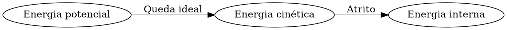

# Energia mecânica e transformações

**Objetivo:** distinguir conservação de energia total e de energia mecânica.
**Extensões:** Graphviz, MathJax.

## Ideias centrais

A energia cinética é $K=mv^2/2$. Perto da superfície terrestre, a energia
potencial gravitacional pode ser escrita como $U=mgh$, tomando uma altura de
referência. A energia mecânica é $E=K+U$.

Uma esfera de 1 kg solta de 5 m, sem resistência do ar, tem inicialmente 50 J
de energia potencial se adotarmos $g=10$ m/s². Ao chegar à altura zero, esses
50 J tornam-se energia cinética: sua rapidez é 10 m/s.

O diagrama distingue o caso ideal do caso com resistência. Com atrito, a
energia mecânica pode diminuir e aumentar a energia interna dos corpos e do
ambiente. Isso não significa desaparecimento de energia total. O valor de $U$
depende da referência, mas diferenças de energia potencial entre duas alturas
não dependem dessa escolha.

## Pratique

1. Calcule a energia cinética de 2 kg a 3 m/s.
2. Dobrar a rapidez dobra a energia cinética?

## Respostas comentadas

1. $K=9$ J.
2. Não: ela é multiplicada por quatro.

## Continue estudando

[Índice da coleção](README.md) · [Voltar aos exercícios](#pratique)

[English](../en/energia-mecanica.md) · [Español](../es/energia-mecanica.md)
