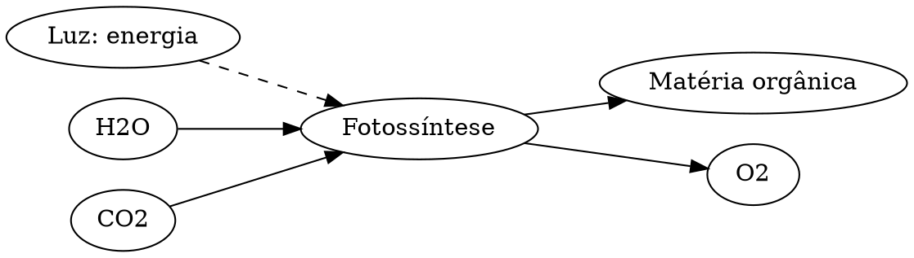

# Fotossíntese: matéria e energia

**Objetivo:** separar fluxo de energia e transformação de substâncias.
**Extensões:** Graphviz, MathJax.

## Ideias centrais

Na fotossíntese oxigênica, a energia luminosa é usada em processos que permitem
sintetizar matéria orgânica a partir de carbono inorgânico. Uma equação global
simplificada é:

$$
\ce{6 CO2 + 6 H2O -> C6H12O6 + 6 O2}.
$$

A equação resume um conjunto de reações, não uma única etapa. O oxigênio
liberado na fotossíntese oxigênica vem da água; a equação simplificada,
sozinha, não revela esse caminho dos átomos. A luz fornece energia, mas não
substitui água e dióxido de carbono como fontes de matéria.

As plantas também respiram, consumindo compostos orgânicos em processos que
disponibilizam energia para as células. Fotossíntese e respiração não são
simplesmente atividades exclusivas de dia e noite.

## Pratique

1. Conte os átomos de carbono na equação.
2. A luz é uma fonte de átomos de carbono?

## Respostas comentadas

1. Há seis de cada lado.
2. Não; a fonte indicada é CO₂.

## Continue estudando

[Índice da coleção](README.md) · [Voltar aos exercícios](#pratique)

[English](../en/fotossintese.md) · [Español](../es/fotossintese.md)
