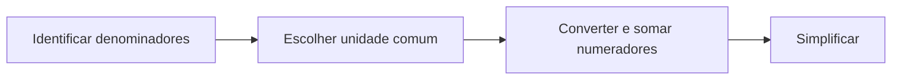

# Frações equivalentes e adição

**Objetivo:** somar frações usando unidades de mesmo tamanho. **Extensões:**
MathJax, Mermaid.

## Ideias centrais

A fração $a/b$, com $b\ne0$, compara uma quantidade com uma divisão da unidade.
Multiplicar numerador e denominador pelo mesmo número não nulo mantém o valor:
$1/2=3/6$. Mudamos a quantidade e o tamanho das partes juntos.

Para somar $1/2+1/3$, escrevemos as parcelas em sextos. Não podemos somar
diretamente os denominadores, pois eles descrevem tamanhos de partes
diferentes.

$$
\frac12+\frac13=\frac36+\frac26=\frac56.
$$

O mínimo múltiplo comum dos denominadores oferece um denominador comum pequeno,
mas outros múltiplos comuns também funcionam. Simplificar o resultado reduz a
escrita sem mudar a quantidade. O mesmo raciocínio vale para medidas de
comprimento e tempo quando usamos a mesma unidade.

## Pratique

1. Calcule $1/4+1/6$.
2. Explique por que $2/4$ e $1/2$ representam o mesmo valor.

## Respostas comentadas

1. $3/12+2/12=5/12$.
2. Duas partes de tamanho um quarto formam metade da unidade.

## Continue estudando

[Índice da coleção](README.md) · [Voltar aos exercícios](#pratique)

[English](../en/fracoes-equivalentes.md) ·
[Español](../es/fracoes-equivalentes.md)
