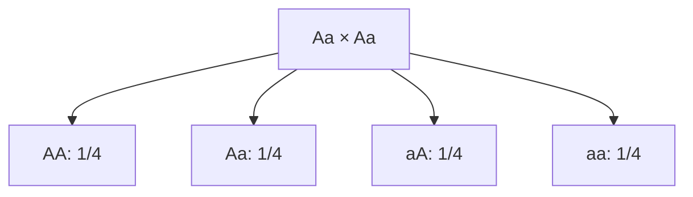

# Genética: um cruzamento monohíbrido

**Objetivo:** interpretar probabilidades em um modelo de herança simples.
**Extensões:** Mermaid, MathJax.

## Ideias centrais

Considere um modelo com dois alelos, $A$ e $a$, segregação regular e dominância
completa de $A$. Um indivíduo $Aa$ produz gametas com $A$ ou $a$, cada um com
probabilidade $1/2$. No cruzamento $Aa\times Aa$, com combinações
equiprováveis, obtemos:

Os genótipos têm proporções esperadas $1/4$ AA, $1/2$ Aa e $1/4$ aa. Com
dominância completa, AA e Aa apresentam o mesmo fenótipo no modelo: a razão
fenotípica esperada é 3:1. Essa razão não exige que cada grupo de quatro
descendentes contenha exatamente três e um.

Muitos caracteres reais envolvem vários genes, ambiente ou outras relações
entre alelos. O diagrama é um modelo de probabilidade e não uma regra universal
para qualquer característica biológica.

## Pratique

1. Qual é a probabilidade de um descendente heterozigoto?
2. Qual é a probabilidade de dois descendentes aa, em eventos independentes?

## Respostas comentadas

1. $1/2$.
2. $(1/4)(1/4)=1/16$, dentro das hipóteses.

## Continue estudando

[Índice da coleção](README.md) · [Voltar aos exercícios](#pratique)

[English](../en/genetica-mendeliana.md) ·
[Español](../es/genetica-mendeliana.md)
