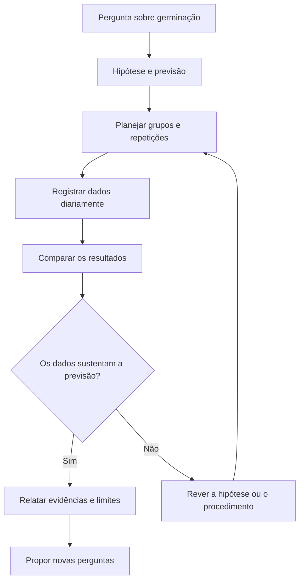

# Investigar a germinação de sementes

**Objetivo:** distinguir hipótese, controle, observação e conclusão.
**Extensão:** Mermaid.

## Uma pergunta testável

“A disponibilidade de água altera a germinação?” permite propor uma
investigação. Compare sementes da mesma espécie e lote, mantendo temperatura,
iluminação e recipiente semelhantes. Varie a água de forma planejada e registre
quantas sementes germinam em cada grupo. Use mais de uma semente por condição.

## Evidência não é certeza absoluta

Se um grupo germinar menos, considere também erros de medição, diferenças entre
sementes e quantidade de repetições. Uma associação observada em um experimento
mal controlado pode não refletir o efeito da variável estudada. Não descarte
dados apenas porque contrariam a hipótese.

## Pratique

1. Identifique a variável manipulada e a variável observada.
2. Por que repetir o experimento?
3. Formule uma conclusão caso 8 de 10 sementes germinem com água moderada e 2
   de 10 germinem sem rega, nas condições adotadas.

## Respostas comentadas

1. Manipulada: disponibilidade de água; observada: germinação.
2. Repetições ajudam a avaliar a variabilidade e a consistência dos resultados.
3. Nesse ensaio, a condição com água moderada apresentou mais germinações; o
   resultado não define sozinho uma regra para todas as espécies e ambientes.
