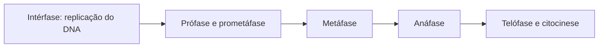

# Mitose e organização do ciclo celular

**Objetivo:** ordenar etapas e distinguir replicação do DNA de divisão celular.
**Extensões:** Mermaid.

## Ideias centrais

Antes da mitose, o DNA é replicado na fase S da intérfase. Durante a mitose, os
cromossomos duplicados são distribuídos aos núcleos filhos. A citocinese divide
o citoplasma e geralmente acompanha o final do processo.

Na prófase ocorre condensação dos cromossomos; a prometáfase inclui
reorganização do envoltório nuclear. Na metáfase, os cromossomos se alinham; na
anáfase, as cromátides-irmãs se separam. Na telófase, formam-se os novos
núcleos. O diagrama agrupa etapas para uma primeira leitura.

No modelo usual de divisão somática, o número de cromossomos é conservado nas
células filhas. Replicar DNA não significa imediatamente duplicar o número de
cromossomos contado por centrômeros. Diferencie esse processo da meiose, que
envolve duas divisões e redução do número cromossômico.

## Pratique

1. Em que etapa ocorre a replicação do DNA?
2. Qual evento caracteriza a anáfase?

## Respostas comentadas

1. Na fase S da intérfase, antes da mitose.
2. A separação das cromátides-irmãs.

## Continue estudando

[Índice da coleção](README.md) · [Voltar aos exercícios](#pratique)

[English](../en/mitose.md) · [Español](../es/mitose.md)
