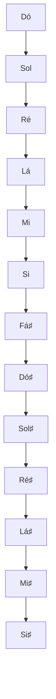
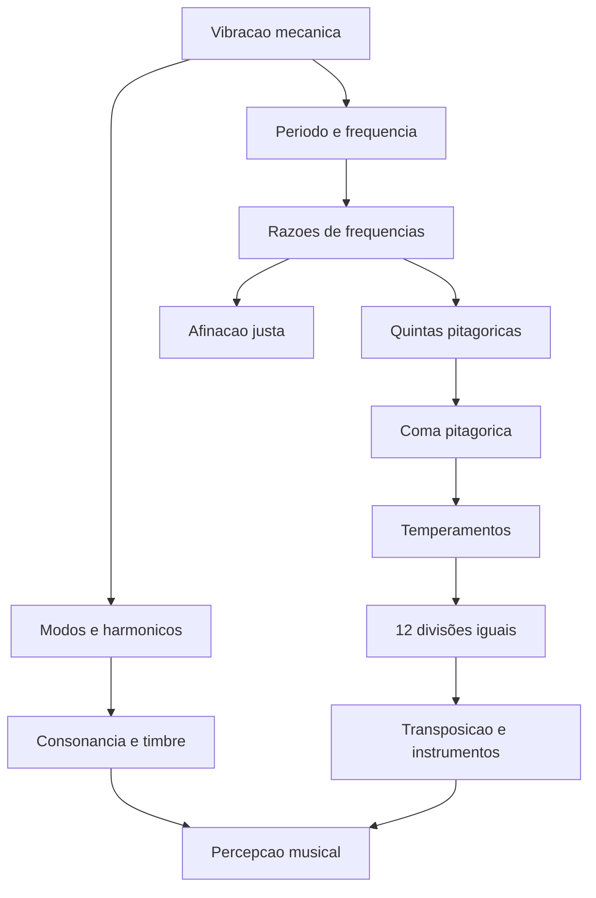

# A matemática e a física da música: de Pitágoras ao temperamento igual

> **Objetivo:** compreender como vibrações produzem sons, como razões numéricas
> descrevem intervalos musicais e por que diferentes sistemas de afinação
> coexistem. Este texto combina história, física, matemática e notação musical.
>
> **Extensões utilizadas:** `mathjax`, `abc`, `verovio`, `maps`, `vega-lite`,
> `mermaid`, `didactic`, `cross-references`, `heading-ids` e `relative-urls`.
> As extensões devem ser habilitadas no aplicativo que renderiza o documento.
> Alguns recursos requerem bibliotecas opcionais e capacidades do host.

## 1. Uma pergunta que atravessa os séculos

Por que duas notas tocadas simultaneamente podem soar estáveis e consonantes,
enquanto outras produzem uma sensação de tensão? O que distingue uma nota de
outra? E por que um piano moderno pode tocar em diferentes tonalidades sem ser
afinado novamente?

A música é uma prática humana e cultural muito anterior à formulação de uma
teoria física do som. Entretanto, certas propriedades de instrumentos e
vibrações podem ser medidas. A partir delas, construímos modelos matemáticos
que ajudam a compreender alturas, intervalos, timbres, escalas e acordes. Esses
modelos não determinam, sozinhos, a experiência estética: consonância e
dissonância também dependem do contexto histórico, do repertório, da
aprendizagem auditiva e do timbre.

## 2. Pitágoras, Samos e a tradição da harmonia numérica

Pitágoras viveu aproximadamente no século VI a.C. e é tradicionalmente
associado à ilha de **Samos**, no mar Egeu. Mais tarde, estabeleceu-se em
**Crotona** (atual Crotone), no sul da península Itálica, onde se desenvolveu a
comunidade pitagórica. A tradição relaciona essa escola à ideia de que relações
numéricas podem organizar fenômenos da natureza, entre eles os intervalos
musicais.

É importante separar **atribuição tradicional** de **demonstração histórica**.
Não sobreviveram escritos autênticos de Pitágoras. Histórias sobre martelos de
ferreiros, cordas e experiências com sons foram transmitidas e ampliadas por
autores posteriores; não devem ser lidas como registros experimentais
contemporâneos. Além disso, há evidências de pensamento matemático-musical
anterior na Mesopotâmia. O mérito histórico da tradição pitagórica reside,
sobretudo, na influência duradoura da interpretação numérica da harmonia.

<!-- prettier-ignore -->
::: figure Samos e centros do Mediterrâneo antigo relacionados à circulação de conhecimentos {#mapa-antigo}

```geojson
{
    "type": "FeatureCollection",
    "features": [
        {
            "type": "Feature",
            "properties": {
                "name": "Samos",
                "label": "Samos",
                "title": "Samos"
            },
            "geometry": {
                "type": "Point",
                "coordinates": [
                    26.98,
                    37.75
                ]
            }
        },
        {
            "type": "Feature",
            "properties": {
                "name": "Crotona",
                "label": "Crotona",
                "title": "Crotona"
            },
            "geometry": {
                "type": "Point",
                "coordinates": [
                    17.13,
                    39.08
                ]
            }
        },
        {
            "type": "Feature",
            "properties": {
                "name": "Mileto (Jônia)"
            },
            "geometry": {
                "type": "Point",
                "coordinates": [
                    27.28,
                    37.53
                ]
            }
        },
        {
            "type": "Feature",
            "properties": {
                "name": "Atenas"
            },
            "geometry": {
                "type": "Point",
                "coordinates": [
                    23.73,
                    37.98
                ]
            }
        },
        {
            "type": "Feature",
            "properties": {
                "name": "Siracusa"
            },
            "geometry": {
                "type": "Point",
                "coordinates": [
                    15.29,
                    37.08
                ]
            }
        },
        {
            "type": "Feature",
            "properties": {
                "name": "Alexandria (fundada posteriormente)"
            },
            "geometry": {
                "type": "Point",
                "coordinates": [
                    29.92,
                    31.20
                ]
            }
        }
    ]
}
```

:::

**Leitura histórica do mapa:** as coordenadas são aproximações modernas. Os
pontos não representam fronteiras antigas nem comprovam itinerários pessoais de
Pitágoras. Alexandria aparece como referência à transmissão posterior do
conhecimento, não como cidade contemporânea à vida de Pitágoras.

A expressão **música das esferas** designa uma concepção filosófica antiga que
associa ordem cósmica e proporções harmônicas. Não significa que planetas
produzam, no espaço vazio, sons audíveis: o som mecânico necessita de um meio
material para se propagar.

## 3. O que é um som musical?

Uma fonte sonora faz o meio ao redor vibrar. Em um modelo simples, a pressão
acústica em um ponto pode variar aproximadamente como

$$p(t)=p_0+A\sin(2\pi ft+\varphi),$$

em que $A$ é a amplitude, $f$ a frequência (em hertz), $t$ o tempo e $\varphi$
a fase inicial. A frequência corresponde ao número de ciclos por segundo e está
fortemente associada à **altura** percebida; a amplitude está relacionada à
intensidade física, embora a sensação de volume também dependa de frequência,
duração e percepção.

<!-- prettier-ignore -->
::: definition Frequência e período {#frequencia-periodo}

Para uma oscilação periódica, o período $T$ é o tempo de um ciclo:

$$\boxed{f=\frac{1}{T}}.$$

Um Lá de $440\,\mathrm{Hz}$ completa 440 ciclos por segundo e tem período de
aproximadamente $2{,}27\,\mathrm{ms}$.

:::

<!-- prettier-ignore -->
::: figure Uma oscilação senoidal amostrada ao longo do tempo {#grafico-onda}

```vega-lite
{
  "$schema":"https://vega.github.io/schema/vega-lite/v5.json",
  "description":"Onda de 440 Hz representada por amostras em 10 ms.",
  "data":{"sequence":{"start":0,"stop":10.05,"step":0.05,"as":"t"}},
  "transform":[{"calculate":"sin(2*PI*440*datum.t/1000)","as":"p"}],
  "mark":{"type":"line","strokeWidth":2},
  "encoding":{
    "x":{"field":"t","type":"quantitative","title":"Tempo (ms)"},
    "y":{"field":"p","type":"quantitative","title":"Pressão relativa (unidade arbitrária)","scale":{"domain":[-1.1,1.1]}}
  },
  "width":"container","height":220
}
```

:::

Sons reais normalmente não são senoides puras. Uma corda vibrante, uma coluna
de ar ou uma membrana pode produzir uma combinação de frequências. É essa
estrutura espectral, somada ao ataque e à evolução temporal do som, que
contribui para o **timbre**.

## 4. O monocórdio: comprimento, tensão e frequência

O **monocórdio** é um instrumento de estudo constituído por uma corda esticada
sobre uma caixa de ressonância, cuja parte vibrante pode ser encurtada por um
apoio móvel. É especialmente útil para investigar intervalos.

Para uma corda ideal, homogênea, de comprimento vibrante $L$, tensão $F$ e
densidade linear $\mu$, a frequência fundamental é

$$\boxed{f_1=\frac{1}{2L}\sqrt{\frac{F}{\mu}}}.$$

Mantendo tensão e densidade linear constantes, obtemos

$$f_1\propto\frac{1}{L}\quad\Longrightarrow\quad \frac{f_2}{f_1}=\frac{L_1}{L_2}.$$

Assim, uma corda reduzida à metade do comprimento vibra com frequência duas
vezes maior. Reduzi-la a dois terços do comprimento produz frequência $3/2$ da
original.

<!-- prettier-ignore -->
::: table Comprimento vibrante e intervalo em relação à corda inteira {#tabela-monocordio}

| Comprimento $L'/L$ | Razão de frequência $f'/f$ | Intervalo         |
| -----------------: | -------------------------: | ----------------- |
|                $1$ |                      $1:1$ | Uníssono          |
|              $4/5$ |                      $5:4$ | Terça maior justa |
|              $3/4$ |                      $4:3$ | Quarta justa      |
|              $2/3$ |                      $3:2$ | Quinta justa      |
|              $1/2$ |                      $2:1$ | Oitava            |

:::

Observe que **comprimentos e frequências são inversamente proporcionais**. A
relação $2:3$ entre comprimentos corresponde à relação $3:2$ entre frequências.
A frequência também muda com a tensão: duplicar a tensão não duplica a
frequência; multiplica-a por $\sqrt{2}$.

<!-- prettier-ignore -->
::: exercise Experiência com o monocórdio {#exercicio-monocordio}

Uma corda de $80\,\mathrm{cm}$ produz uma frequência fundamental de
$220\,\mathrm{Hz}$. Mantendo a tensão, qual comprimento produzirá
$330\,\mathrm{Hz}$?

<!-- prettier-ignore -->
::: hint

Use $f_2/f_1=L_1/L_2$.

:::

<!-- prettier-ignore -->
::: solution Resolução

$$L_2=80\frac{220}{330}=\frac{160}{3}\,\mathrm{cm}\approx53{,}33\,\mathrm{cm}.$$

O novo comprimento corresponde a $2/3$ do inicial: uma quinta justa acima.

:::

:::

## 5. A série harmônica e a consonância

Uma corda fixa nas duas extremidades admite modos estacionários cujas
frequências ideais são

$$\boxed{f_n=nf_1\qquad(n=1,2,3,\ldots)}.$$

Se a fundamental vale $220\,\mathrm{Hz}$, seus primeiros harmônicos são $220$,
$440$, $660$, $880$, $1100$ e $1320\,\mathrm{Hz}$. O segundo harmônico
corresponde à oitava; o terceiro, reduzido uma oitava, corresponde à quinta
justa; o quinto, reduzido duas oitavas, corresponde à terça maior justa.

<!-- prettier-ignore -->
::: figure Frequências dos oito primeiros harmônicos de uma fundamental de 220 Hz {#grafico-harmonicos}

```vega-lite
{
  "$schema":"https://vega.github.io/schema/vega-lite/v5.json",
  "data":{"values":[{"n":"1","f":220},{"n":"2","f":440},{"n":"3","f":660},{"n":"4","f":880},{"n":"5","f":1100},{"n":"6","f":1320},{"n":"7","f":1540},{"n":"8","f":1760}]},
  "mark":"bar",
  "encoding":{"x":{"field":"n","type":"ordinal","title":"Ordem do harmônico"},"y":{"field":"f","type":"quantitative","title":"Frequência (Hz)"},"tooltip":[{"field":"n"},{"field":"f"}]},
  "width":"container","height":220
}
```

:::

Quando dois sons têm frequências fundamentais em razões simples, parte de seus
harmônicos pode coincidir. Para $440\,\mathrm{Hz}$ e $660\,\mathrm{Hz}$:

$$3(440)=2(660)=1320\,\mathrm{Hz}.$$

A coincidência contribui para a consonância da quinta justa, mas **não
constitui uma explicação universal de preferências musicais**. Timbres
inarmônicos, como os de sinos, e tradições musicais distintas mostram os
limites de uma interpretação puramente numérica.

## 6. Intervalos musicais: razões, não diferenças

Um **intervalo** entre frequências $f_a$ e $f_b$ pode ser representado pela
razão $r=f_b/f_a$. Ao subir uma oitava, multiplicamos por 2; ao subir duas,
multiplicamos por 4. Ao subir uma quinta justa, multiplicamos por $3/2$.

<!-- prettier-ignore -->
::: definition Oitava {#def-oitava}

Duas notas separadas por uma oitava possuem razão de frequências $2:1$. Essa
relação independe da frequência inicial: $220\to440$, $440\to880$ e
$880\to1760\,\mathrm{Hz}$ são oitavas.

:::

Como multiplicações de razões correspondem à composição de intervalos, uma
escala musical é naturalmente descrita em termos **multiplicativos**. Essa
observação prepara o uso dos logaritmos.

## 7. Construindo a escala pitagórica

Na **afinação pitagórica**, as notas são obtidas por quintas puras de razão
$3/2$, transportadas por potências de 2 para uma oitava comum. Partindo de Dó,
a sequência de quintas Dó–Sol–Ré–Lá–Mi–Si, e uma quinta descendente para Fá,
produz uma escala diatônica.

<!-- prettier-ignore -->
::: equation Quinta transportada para a mesma oitava {#eq-quintas}

$$r_k=\left(\frac32\right)^k 2^{-m_k},\qquad 1\leq r_k<2,$$

onde o inteiro $m_k$ é escolhido para situar a nota na oitava de referência.

:::

<!-- prettier-ignore -->
::: table Escala pitagórica de dó maior: razões de frequência em relação ao dó inicial {#tabela-pitagorica}

| Nota | Grau | Razão $f/f_{\mathrm{Dó}}$ | Aproximação |
| ---- | ---- | ------------------------: | ----------: |
| Dó   | I    |                     $1/1$ |    1,000000 |
| Ré   | II   |                     $9/8$ |    1,125000 |
| Mi   | III  |                   $81/64$ |    1,265625 |
| Fá   | IV   |                     $4/3$ |    1,333333 |
| Sol  | V    |                     $3/2$ |    1,500000 |
| Lá   | VI   |                   $27/16$ |    1,687500 |
| Si   | VII  |                 $243/128$ |    1,898438 |
| Dó   | VIII |                     $2/1$ |    2,000000 |

:::

<!-- prettier-ignore -->
A partitura a seguir utiliza notas de duração ampliada e largura de pauta configurada para melhorar o espaçamento horizontal das frações. A largura final também depende das regras CSS do renderizador ABC. Ela mostra os **nomes e as alturas notadas** da escala. As frações na {@ref tabela-pitagorica} especificam sua afinação física: uma partitura convencional, isoladamente, não fixa essas razões.

<!-- prettier-ignore -->
::: figure Partitura da escala de dó maior associada às razões pitagóricas {#partitura-pitagorica}

```abc
X:1
T:Escala de do maior - graus pitagoricos
C:Exemplo didatico
M:4/4
L:1/2
%%stretchlast 1
%%staffwidth 1000
K:C
C2 D2 E2 F2 | G2 A2 B2 c2 |]
w: 1/1 9/8 81/64 4/3 3/2 27/16 243/128 2/1
```

:::

**Nota sobre a execução:** o ABC registra as notas e as sílabas com as frações,
mas a reprodução sonora oferecida pelo renderizador poderá empregar
temperamento igual. Para ouvir as frequências pitagóricas, é necessário um
sintetizador com afinação configurável.

A escala pitagórica tem dois tamanhos de passo: o tom $9/8$ e o semitom
diatônico $256/243$ (também chamado _limma_). Seu padrão ascendente é
tom–tom–semitom–tom–tom–tom–semitom. A terça maior pitagórica vale $81/64$,
diferente da terça maior justa $5/4$.

## 8. Afinação justa: outro sistema não temperado

A expressão **não temperada** não designa uma única escala. A afinação
pitagórica privilegia quintas puras, ao passo que uma **afinação justa de cinco
limites** (_5-limit just intonation_) utiliza também o fator primo 5 para
construir intervalos como a terça maior $5/4$.

<!-- prettier-ignore -->
::: table Duas maneiras de afinar uma escala maior em dó {#tabela-justa}

| Nota | Pitagórica | Justa de cinco limites (uma realização possível) |
| ---- | ---------: | -----------------------------------------------: |
| Dó   |      $1/1$ |                                            $1/1$ |
| Ré   |      $9/8$ |                                            $9/8$ |
| Mi   |    $81/64$ |                                            $5/4$ |
| Fá   |      $4/3$ |                                            $4/3$ |
| Sol  |      $3/2$ |                                            $3/2$ |
| Lá   |    $27/16$ |                                            $5/3$ |
| Si   |  $243/128$ |                                           $15/8$ |
| Dó   |      $2/1$ |                                            $2/1$ |

:::

A terça maior justa $5/4$ é mais estreita do que a terça maior pitagórica
$81/64$. A razão entre ambas é

$$\frac{81/64}{5/4}=\frac{81}{80},$$

conhecida como **coma sintônica**. Na prática, uma afinação justa pode depender
do contexto harmônico; não existe necessariamente uma única frequência fixa
para cada nome de nota em todas as progressões.

## 9. O problema do ciclo das quintas

Se partirmos de Dó e avançarmos por quintas, obtemos a sequência de nomes Dó –
Sol – Ré – Lá – Mi – Si – Fá♯ – Dó♯ – Sol♯ – Ré♯ – Lá♯ – Mi♯ – Si♯. No teclado
temperado, Si♯ corresponde à mesma tecla que Dó. Entretanto, **doze quintas
puras não chegam exatamente à mesma frequência que sete oitavas**.



<!-- prettier-ignore -->
::: equation A coma pitagórica {#eq-coma}

$$\boxed{\frac{(3/2)^{12}}{2^7}=\frac{531441}{524288}\approx1{,}0136433.}$$

:::

A diferença corresponde a cerca de **23,46 cents**, pouco menos de um quarto de
semitom temperado. Por isso, em um conjunto fechado de doze notas, não é
possível manter simultaneamente todas as quintas em $3/2$ e todas as oitavas em
$2/1$. Algum intervalo terá de absorver o desajuste ou vários intervalos
precisarão ser modificados.

Em certas afinações históricas, essa discrepância se manifesta como um
intervalo especialmente desafinado, a chamada **quinta do lobo**.

## 10. O que significa temperar uma escala?

**Temperar** é ajustar deliberadamente intervalos em relação a proporções puras
para obter outras vantagens musicais. Há temperamentos desiguais, como os
mesotônicos e vários bons temperamentos históricos, e temperamentos iguais.

No **temperamento igual de doze divisões da oitava** (12-TET), cada semitom
possui a mesma razão de frequências:

<!-- prettier-ignore -->
::: equation Frequência de uma nota no temperamento igual {#eq-12tet}

$$\boxed{f_n=f_0\,2^{n/12}},\qquad n\in\mathbb{Z}.$$

:::

Assim, a razão entre duas notas separadas por sete semitons é
$2^{7/12}\approx1{,}498307$, ligeiramente menor do que a quinta pura
$3/2=1{,}5$. As oitavas continuam exatamente em $2/1$.

<!-- prettier-ignore -->
::: table Frequências a partir do Lá de 440 Hz no 12-TET {#tabela-frequencias}

| Nota | Semitons acima de Lá | Frequência (Hz) |
| ---- | -------------------: | --------------: |
| Lá   |                    0 |          440,00 |
| Lá♯  |                    1 |          466,16 |
| Si   |                    2 |          493,88 |
| Dó   |                    3 |          523,25 |
| Dó♯  |                    4 |          554,37 |
| Ré   |                    5 |          587,33 |
| Ré♯  |                    6 |          622,25 |
| Mi   |                    7 |          659,26 |
| Fá   |                    8 |          698,46 |
| Fá♯  |                    9 |          739,99 |
| Sol  |                   10 |          783,99 |
| Sol♯ |                   11 |          830,61 |
| Lá   |                   12 |          880,00 |

:::

A principal vantagem prática é a **transposição**: uma mesma estrutura
intervalar pode ser deslocada para outra tonalidade sem mudar o padrão de
afinação do instrumento. A solução envolve um compromisso: a maioria dos
intervalos não coincide exatamente com as razões simples da afinação justa.

## 11. Como medir diferenças tão pequenas? O cent

Para comparar intervalos, emprega-se a unidade logarítmica **cent**: uma oitava
tem 1200 cents, e cada semitom do 12-TET tem 100 cents.

<!-- prettier-ignore -->
::: equation Medida logarítmica de um intervalo {#eq-cent}

$$\boxed{c=1200\log_2\left(\frac{f_2}{f_1}\right)}.$$

:::

A escala logarítmica transforma a multiplicação de razões na soma de
intervalos: uma quinta seguida de uma quarta forma uma oitava, porque
$(3/2)(4/3)=2$.

<!-- prettier-ignore -->
::: table Intervalos justos, pitagóricos e temperados {#tabela-comparacao}

| Intervalo              | Razão pura selecionada | Cents da razão pura | Cents no 12-TET |
| ---------------------- | ---------------------: | ------------------: | --------------: |
| Terça maior justa      |                  $5/4$ |              386,31 |          400,00 |
| Terça maior pitagórica |                $81/64$ |              407,82 |          400,00 |
| Quarta justa           |                  $4/3$ |              498,04 |          500,00 |
| Quinta justa           |                  $3/2$ |              701,96 |          700,00 |
| Oitava                 |                  $2/1$ |             1200,00 |         1200,00 |

:::

<!-- prettier-ignore -->
::: figure Diferença de afinação em relação ao 12-TET, medida em cents {#grafico-desvios}

```vega-lite
{
  "$schema":"https://vega.github.io/schema/vega-lite/v5.json",
  "data":{"values":[
    {"intervalo":"Terça maior justa","desvio":-13.686},
    {"intervalo":"Terça maior pitagórica","desvio":7.820},
    {"intervalo":"Quarta justa","desvio":-1.955},
    {"intervalo":"Quinta justa","desvio":1.955},
    {"intervalo":"Oitava","desvio":0}
  ]},
  "mark":"bar",
  "encoding":{
    "y":{"field":"intervalo","type":"nominal","sort":null,"title":null},
    "x":{"field":"desvio","type":"quantitative","title":"Desvio em relação ao temperamento igual (cents)","scale":{"domain":[-16,10]}},
    "tooltip":[{"field":"intervalo"},{"field":"desvio","format":".2f"}]
  },
  "width":"container","height":220
}
```

:::

## 12. Por que precisamente doze notas por oitava?

A escolha de doze divisões não é uma imposição da natureza. Trata-se de uma
solução histórica, favorecida pela tradição de organizar notas por quintas e
pela boa aproximação matemática entre doze quintas e sete oitavas:

$$\left(\frac32\right)^{12}\approx2^7.$$

Em logaritmos, a quinta pura ocupa $\log_2(3/2)\approx0{,}5849625$ oitava. A
aproximação racional

$$\frac7{12}\approx0{,}5833333$$

indica que uma quinta pode ser representada por **sete passos em uma divisão
igual de doze passos por oitava**. A diferença é apenas $1{,}955$ cents por
quinta.

Para uma divisão igual em $N$ passos, a quinta pode ser aproximada por $k$
passos, onde

$$\boxed{\frac{k}{N}\approx\log_2(3/2).}$$

<!-- prettier-ignore -->
::: table Outras divisões iguais possíveis {#tabela-edos}

| Divisões $N$ | Passos $k$ para a quinta | Quinta aproximada (cents) | Erro ante 701,955 cents |
| -----------: | -----------------------: | ------------------------: | ----------------------: |
|           10 |                        6 |                    720,00 |                  +18,05 |
|           12 |                        7 |                    700,00 |                   −1,96 |
|           19 |                       11 |                    694,74 |                   −7,22 |
|           24 |                       14 |                    700,00 |                   −1,96 |
|           31 |                       18 |                    696,77 |                   −5,18 |
|           53 |                       31 |                    701,89 |                   −0,07 |

:::

A divisão em **24 partes** mantém a quinta aproximada do 12-TET, mas acrescenta
notas intermediárias de 50 cents; pode ser útil para repertórios microtonais. A
divisão em **19 partes** fornece outras relações e características expressivas.
A divisão em **53 partes** aproxima a quinta pura com notável precisão, mas
exige mais alturas distintas por oitava. Nenhum desses sistemas é
universalmente superior: cada um equilibra objetivos diferentes, como número de
notas, proximidade de razões puras e práticas culturais.

O uso de doze notas na tradição ocidental não decorreu apenas de um cálculo:
envolve história dos instrumentos, notação, repertório, contraponto, harmonia e
convenções de execução. A difusão do **temperamento igual de 12 notas** ocorreu
gradualmente; ele não deve ser confundido com a origem histórica de escalas
cromáticas de doze classes de altura.

## 13. Batimentos: quando duas frequências quase coincidem

Se duas senoides de frequências próximas são somadas, a identidade
trigonométrica

$$\sin(2\pi f_1t)+\sin(2\pi f_2t)=2\cos\!\left(\pi(f_1-f_2)t\right)\sin\!\left(\pi(f_1+f_2)t\right)$$

mostra uma oscilação rápida modulada por uma envoltória lenta. A frequência dos
batimentos percebidos, em condições apropriadas, é $|f_1-f_2|$.

Considere a quinta justa sobre Lá $440\,\mathrm{Hz}$: sua nota superior vale
$660\,\mathrm{Hz}$. A quinta temperada vale aproximadamente
$659{,}255\,\mathrm{Hz}$. Comparando a terceira harmônica da nota inferior com
a segunda da nota superior:

- Quinta justa: $3(440)=2(660)=1320\,\mathrm{Hz}$ — coincidência exata.
- Quinta temperada: $3(440)=1320\,\mathrm{Hz}$ e
  $2(659{,}255)\approx1318{,}51\,\mathrm{Hz}$ — diferença de aproximadamente
  $1{,}49\,\mathrm{Hz}$.

Isso pode produzir uma modulação lenta quando essas componentes estão presentes
com intensidade suficiente. A percepção real depende da intensidade, do timbre,
do ambiente e do ouvido.

## 14. Partitura, afinação e execução: três camadas diferentes

Uma **partitura** registra relações musicais como nomes de notas, durações,
compassos e articulações. Uma **afinação** associa frequências concretas às
notas. Uma **execução** realiza esses sons com instrumentos e intérpretes
específicos.

<!-- prettier-ignore -->
::: figure Mesma escala escrita em MEI: a afinação precisa ser definida separadamente {#partitura-mei}

```mei
<?xml version="1.0" encoding="UTF-8"?>
<mei xmlns="http://www.music-encoding.org/ns/mei" meiversion="5.0">
  <meiHead><fileDesc><titleStmt><title>Escala de do maior</title></titleStmt><pubStmt/></fileDesc></meiHead>
  <music><body><mdiv><score>
    <scoreDef meter.count="4" meter.unit="4"><staffGrp><staffDef n="1" lines="5" clef.shape="G" clef.line="2"/></staffGrp></scoreDef>
    <section>
      <measure n="1"><staff n="1"><layer n="1"><note pname="c" oct="4" dur="4"/><note pname="d" oct="4" dur="4"/><note pname="e" oct="4" dur="4"/><note pname="f" oct="4" dur="4"/></layer></staff></measure>
      <measure n="2"><staff n="1"><layer n="1"><note pname="g" oct="4" dur="4"/><note pname="a" oct="4" dur="4"/><note pname="b" oct="4" dur="4"/><note pname="c" oct="5" dur="4"/></layer></staff></measure>
    </section>
  </score></mdiv></body></music>
</mei>
```

:::

O mesmo trecho notado pode ser interpretado em afinação pitagórica, justa ou
temperada. Isso é especialmente relevante em instrumentos sem alturas
rigidamente fixadas, como voz e instrumentos de corda sem trastes.

## 15. Síntese: uma rede de relações



A experiência musical revela uma combinação de regularidade física, modelagem
matemática e decisões culturais. Pitágoras tornou-se símbolo dessa relação
porque a tradição pitagórica associou consonância e proporção. O monocórdio
mostra por que o comprimento de uma corda importa; a série harmônica esclarece
a presença de frequências relacionadas; as escalas mostram como selecionamos
certas alturas; e a coma pitagórica demonstra que escolhas aparentemente
simples podem conduzir a um problema matemático sem solução exata dentro de
doze quintas puras e sete oitavas.

O temperamento igual não substituiu uma suposta afinação natural universal. Ele
representa uma solução particularmente útil para práticas musicais que exigem
transposição e circulação por diversas tonalidades. Outras afinações continuam
válidas e expressivas em numerosos contextos.

## 16. Atividades de investigação

<!-- prettier-ignore -->
::: exercise Atividade 1 — Calcular a frequência {#atividade-frequencia}

Tomando $f_0=256\,\mathrm{Hz}$ como dó de referência, calcule as frequências do
mi pitagórico ($81/64$), do mi justo ($5/4$) e do mi temperado ($2^{4/12}$).
Compare os resultados.

<!-- prettier-ignore -->
::: solution Resposta comentada

Mi pitagórico: $256(81/64)=324\,\mathrm{Hz}$. Mi justo:
$256(5/4)=320\,\mathrm{Hz}$. Mi temperado:
$256\,2^{1/3}\approx322{,}54\,\mathrm{Hz}$. A diferença mostra que um mesmo
nome de nota pode corresponder a frequências distintas conforme o sistema.

:::

:::

<!-- prettier-ignore -->
::: exercise Atividade 2 — Verificar a coma {#atividade-coma}

Calcule $(3/2)^{12}/2^7$ e explique por que seu resultado impede fechar
exatamente um ciclo de doze quintas puras.

<!-- prettier-ignore -->
::: solution Resposta comentada

O resultado é $531441/524288\approx1{,}0136433$, maior do que 1. Portanto, as
frequências finais não coincidem; a diferença é a coma pitagórica.

:::

:::

<!-- prettier-ignore -->
::: exercise Atividade 3 — Projetar outro temperamento {#atividade-edo}

Em uma oitava dividida em 19 passos iguais, qual é a razão entre passos
consecutivos? Qual frequência se obtém sete passos acima de $440\,\mathrm{Hz}$?

<!-- prettier-ignore -->
::: solution Resposta comentada

A razão é $2^{1/19}$. Sete passos acima de 440 Hz:
$440\,2^{7/19}\approx568{,}0\,\mathrm{Hz}$. Sete passos de 19-TET não equivalem
à quinta: a aproximação usual da quinta nesse sistema é de onze passos.

:::

:::

<!-- prettier-ignore -->
::: exercise Atividade 4 — Interpretar uma partitura {#atividade-partitura}

<!-- prettier-ignore -->
A partitura da {@ref partitura-pitagorica} é suficiente para determinar a frequência exata de cada nota? Explique a diferença entre notação e afinação.

<!-- prettier-ignore -->
::: solution Resposta comentada

Não. A partitura determina nomes de notas e durações, mas não fixa por si só um
padrão de frequências. É preciso indicar uma nota de referência e um sistema de
afinação. As frações apresentadas no texto completam a especificação
pitagórica.

:::

:::

## Referências e leituras complementares

As páginas seguintes servem como pontos de partida para aprofundamento e
verificação. Os verbetes da Wikipédia são fontes de consulta secundárias, não
substitutos da pesquisa historiográfica especializada.

1. [Pitágoras — Wikipédia em português](https://pt.wikipedia.org/wiki/Pit%C3%A1goras).
2. [Pythagoras — Wikipedia em inglês](https://en.wikipedia.org/wiki/Pythagoras).
3. [Pythagore — Wikipédia em francês](https://fr.wikipedia.org/wiki/Pythagore).
4. [Pitágoras — Wikipedia em espanhol](https://es.wikipedia.org/wiki/Pit%C3%A1goras).
5. [Pythagoreanism — tradição pitagórica e música](https://en.wikipedia.org/wiki/Pythagoreanism).
6. [Pythagorean tuning — afinação pitagórica](https://en.wikipedia.org/wiki/Pythagorean_tuning).
7. [Just intonation — afinação justa](https://en.wikipedia.org/wiki/Just_intonation).
8. [Musical temperament — temperamentos musicais](https://en.wikipedia.org/wiki/Musical_temperament).
9. [Pythagorean comma — coma pitagórica](https://en.wikipedia.org/wiki/Pythagorean_comma).
10. [MathJSLab Markdown — documentação e exemplos](https://github.com/MathJSLab/mathjslab-markdown).
