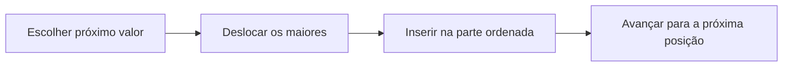

# Ordenação por inserção: construir uma parte ordenada

**Objetivo:** acompanhar comparações e deslocamentos em um algoritmo.
**Extensões:** Mermaid, syntax-highlight.

## Ideias centrais

A ordenação por inserção mantém uma parte inicial do vetor em ordem. A cada
passo, retira o próximo valor, desloca os maiores para a direita e insere o
valor no lugar correto. O processo lembra organizar cartas na mão.



```javascript
function insertionSort(values) {
    for (let i = 1; i < values.length; i += 1) {
        const key = values[i];
        let j = i - 1;
        while (j >= 0 && values[j] > key) {
            values[j + 1] = values[j];
            j -= 1;
        }
        values[j + 1] = key;
    }
    return values;
}
console.log(insertionSort([5, 2, 4, 1]));
```

No vetor $[5,2,4,1]$, inserir 2 transforma a parte inicial em $[2,5]$; inserir
4 produz $[2,4,5]$; inserir 1 termina em $[1,2,4,5]$. O código modifica o vetor
original. O bloco é para leitura e não executa JavaScript no documento.

Usar comparação estrita `>` mantém a ordem relativa de valores iguais nesta
implementação. No pior caso, muitas comparações e deslocamentos são
necessários: o trabalho cresce proporcionalmente a $n^2$. Um vetor já ordenado
exige menos deslocamentos, mostrando que a entrada influencia o custo.

## Pratique

1. Ordene manualmente $[3,1,2]$.
2. O vetor devolvido pelo algoritmo é uma cópia independente?

## Respostas comentadas

1. Após inserir 1: $[1,3,2]$; após inserir 2: $[1,2,3]$.
2. Não; o algoritmo altera o vetor recebido.

## Continue estudando

[Índice da coleção](README.md) · [Voltar aos exercícios](#pratique)

[English](../en/ordenacao-insercao.md) · [Español](../es/ordenacao-insercao.md)
