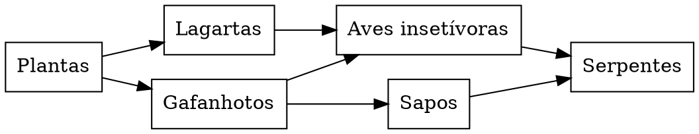

# Biologia: uma rede alimentar simplificada

**Objetivo:** interpretar relações alimentares e fluxo de energia.
**Extensão:** Graphviz.

## O significado das setas

Nesta rede fictícia, a seta vai do organismo consumido ao consumidor: indica a
direção de transferência de matéria e energia. As espécies são grupos
genéricos, e o diagrama não descreve um ecossistema particular.

## Rede e cadeia

Uma cadeia é um percurso, como plantas → gafanhotos → sapos → serpentes. A rede
reúne várias cadeias conectadas. Uma alteração em uma população pode afetar
diferentes caminhos, mas o diagrama não quantifica a intensidade dessas
relações. Decompositores e outros organismos foram omitidos para facilitar a
leitura; não são dispensáveis no ecossistema.

## Pratique

1. Identifique os produtores da rede.
2. Quais consumidores recebem energia diretamente dos gafanhotos?
3. Por que não podemos prever a população de serpentes apenas contando setas?

## Respostas comentadas

1. As plantas.
2. Aves insetívoras e sapos.
3. Faltam quantidades, taxas, outros recursos e interações ambientais.
