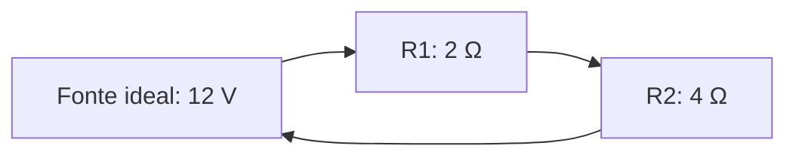

# Resistores em série: corrente e tensão

**Objetivo:** calcular resistência equivalente e dividir a tensão em um modelo
ideal. **Extensões:** Mermaid, MathJax.

## Ideias centrais

Em uma ligação em série há um único caminho para a corrente. Para resistores
ôhmicos ideais, $R_{\mathrm{eq}}=R_1+R_2$. A mesma corrente atravessa ambos,
mas as quedas de tensão podem ser diferentes: $V_i=IR_i$.

O desenho mostra a conectividade de um circuito fechado, não símbolos elétricos
convencionais. Com fonte ideal de 12 V e resistores de 2 Ω e 4 Ω, temos
$R_{\mathrm{eq}}=6$ Ω e $I=12/6=2$ A. As quedas são 4 V e 8 V, cuja soma iguala
a tensão da fonte.

O modelo despreza resistência dos fios e efeitos de temperatura. Tensão é
diferença de potencial; corrente é fluxo de carga. Não são a mesma grandeza e
têm unidades diferentes. Esta é uma atividade de análise em papel.

## Pratique

1. Se a fonte passa a 6 V, qual é a corrente?
2. Qual resistor tem a maior queda de tensão?

## Respostas comentadas

1. 1 A, mantendo as mesmas resistências.
2. O de 4 Ω: com corrente igual, a queda é proporcional à resistência.

## Continue estudando

[Índice da coleção](README.md) · [Voltar aos exercícios](#pratique)

[English](../en/resistores-em-serie.md) ·
[Español](../es/resistores-em-serie.md)
